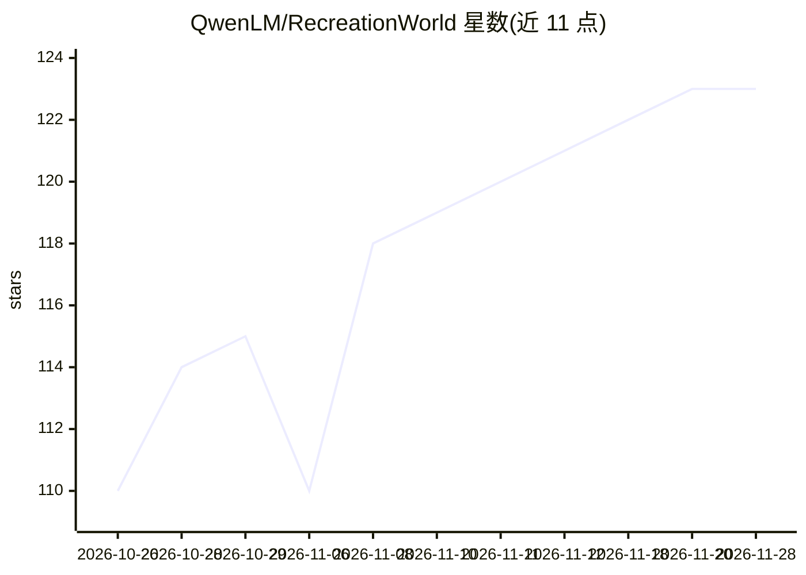

# QwenLM/RecreationWorld

⭐ 123 · Python · MIT · 推送 2026-10-26 · [GitHub](https://github.com/QwenLM/RecreationWorld) · [官网](https://recreation-bench.cc) · 组织维护 · 中文 README

**面向混合计算机使用 agent 的五平台可验证环境与基准**

五平台（Ubuntu/macOS/Windows/Android/Web）框架，用于研究与改进能交替进行 GUI 探索、编码工具实现与视觉验证的混合计算机使用 agent。以运行中的参考应用为可执行 oracle，将开源应用转化为可扩展、可验证的训练经验；配套 RecreationBench 提供 250 个 held-out 任务，通过程序化与视觉断言按可观察行为评分。任务包来自 Hugging Face/ModelScope，运行需模型与 judge 端点，MIT 许可。

## 筛选速览

| 维度 | 判定 | 备注 |
|---|---|---|
| AI 角色 | `ai-ecosystem` | LLM/agent 周边工具 |
| 许可风险 | `permissive` | MIT |
| 部署形态 | `None` |  |
| 模型依赖 | — | README 未给出锁定关系 |
| 硬件要求 | — | 无带数字的原话,不猜 |
| 安装摩擦 | `low` | 无编译、无系统依赖或容器化 |
| 成熟度 | — | 结构信号不足 |

## 能力要点

- 覆盖 Ubuntu/macOS/Windows/Android/Web 五平台的重建任务环境
- explore–implement–verify 循环式 agent 工作流
- RecreationBench：250 个任务，基于隐藏的功能与视觉断言评分
- 评分取决于可观察行为，实现语言与框架不限

## 适用场景

- 评测混合计算机使用 agent 在五个平台上的任务完成率
- 为 agent 生成可验证的训练经验并测其在域外基准的迁移
- 按程序化与视觉双指标对比各模型表现

## 场景标签

`模型评测` `GUI 自动化` · 领域:效率与自动化

## 证据(README 行号)

> L11: RecreationWorld is a five-platform framework for studying and improving **hybrid computer-use agents** that autonom
> L17: Each task gives the agent a high-level request, interactive access to a running reference, and both GUI-control and
> L49: A scored run also needs a matching frozen task bundle from Hugging Face or ModelScope, a prepared execution environ

## 星数曲线

2026-10-26 110 → 2026-11-28 123（+13）

---
*卡片 v1 · prompt 1.4 · 生成 2026-11-28 · 置信度 high · 依据 README sha `b5d94aba7950` · [字段定义](../../DATASET.md)*
