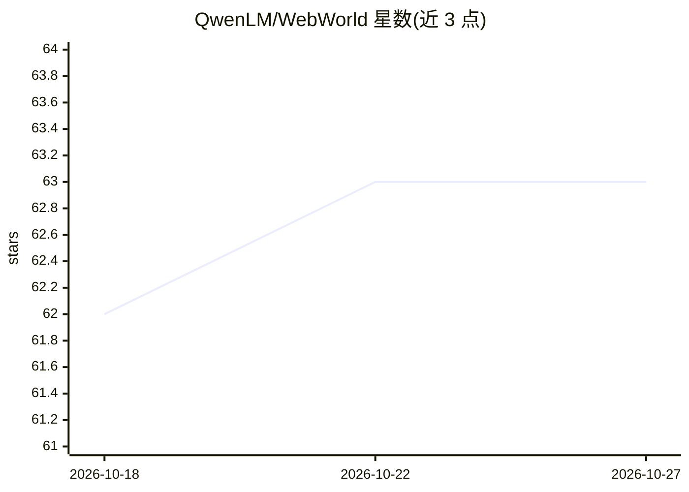

# QwenLM/WebWorld

⭐ 63 · Python · 推送 2026-02-25 · [GitHub](https://github.com/QwenLM/WebWorld) · 组织维护 · 中文 README

**在模拟浏览器中训练 Web Agent 的大规模网页世界模型**

QwenLM 团队发布的网页世界模型系列（8B/14B/32B，基于 Qwen3）：基于 100 万+真实网页交互轨迹训练，用于在模拟环境中替代真实网页训练 agent，规避网络延迟、限流与安全风险。支持 30+ 步多轮模拟与状态跟踪，可在 A11y Tree/HTML/XML/Markdown/自然语言多种表示下预测下一状态；提供统一动作空间（点击、填表、滚动等 Python 风格函数调用）。附带 WebWorld-Bench 评测与 Apache 2.0 开源数据集。

## 筛选速览

| 维度 | 判定 | 备注 |
|---|---|---|
| AI 角色 | `ai-native` | 本体是模型或模型工具 |
| 许可风险 | `none` | — |
| 部署形态 | `library` | 以包/库形式分发 |
| 模型依赖 | — | README 未给出锁定关系 |
| 硬件要求 | — | 无带数字的原话,不猜 |
| 安装摩擦 | `low` | 无编译、无系统依赖或容器化 |
| 成熟度 | — | 结构信号不足 |

## 能力要点

- 1M+ 真实网页交互轨迹训练，模拟替代真实网页训练 agent
- 支持 30+ 步多轮模拟与一致性状态跟踪
- 多格式状态预测：A11y Tree/HTML/XML/Markdown/自然语言
- 提供 8B/14B/32B 模型与 Apache 2.0 开源数据集

## 适用场景

- 在模拟浏览器中生成轨迹训练 Web Agent，避免真实网页的延迟与安全风险
- 用 WebWorld-Bench 的 Factuality/Turing 分数评测世界模型
- 研究世界模型在 API/代码/游戏/GUI 桌面等跨域的泛化

## 场景标签

`浏览器自动化` `模型评测` · 领域:效率与自动化

## 证据(README 行号)

> L14: Web agents require massive trajectories to generalize, yet real-world training is constrained by network latency, r
> L18: - **Trained at Scale**: 1M+ real-world web interaction trajectories via a scalable hierarchical data pipeline (100×
> L27: |**WebWorld-8B**|Qwen3-8B|8B|🤗 HuggingFace|

## 星数曲线

2026-10-18 62 → 2026-10-27 63（+1）

---
*卡片 v1 · prompt 1.4 · 生成 2026-10-24 · 置信度 high · 依据 README sha `a07b13950fa3` · [字段定义](../../DATASET.md)*
