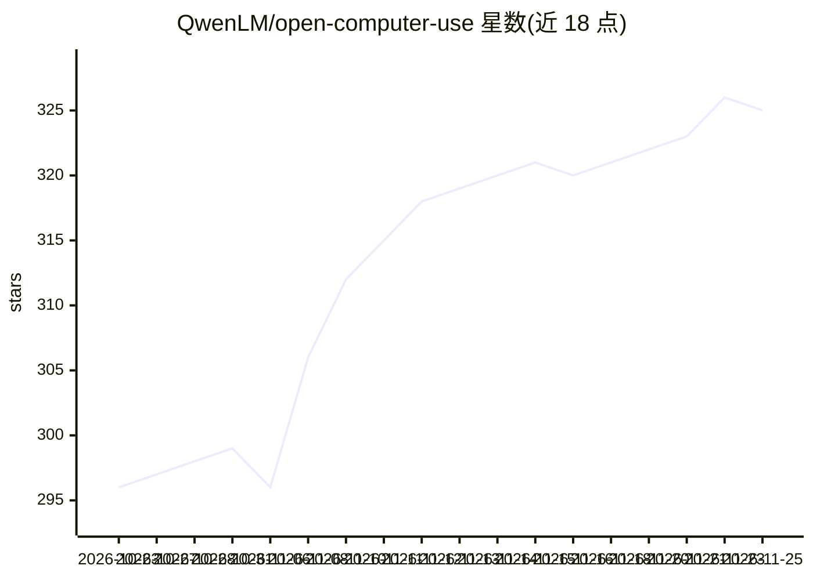

# QwenLM/open-computer-use

⭐ 325 · Rust · Apache-2.0 · 推送 2026-11-09 · [GitHub](https://github.com/QwenLM/open-computer-use) · 组织维护

**供 Qwen Code 及任意 AI agent 调用的跨平台桌面/Browser Use 运行时**

从 Qwen Code 0.28 开发快照中抽取的 Computer Use 与 Browser Use 运行时仓库，包含原生的桌面驱动 cua-driver、TypeScript/Python SDK、常驻 JavaScript MCP 服务器和 Chrome 扩展，可独立于 Qwen Code 运行。通过操作系统辅助功能 API 控制 macOS、Windows 与 Linux X11/XWayland 桌面；浏览器控制需额外安装扩展与原生消息宿主。仅支持源码构建，npm 发布包与原生 release 资产尚未发布，且存在一个未解决的 macOS 原生崩溃问题待调查。

## 筛选速览

| 维度 | 判定 | 备注 |
|---|---|---|
| AI 角色 | `ai-ecosystem` | LLM/agent 周边工具 |
| 许可风险 | `permissive` | Apache-2.0 |
| 部署形态 | `library` | 以包/库形式分发 |
| 模型依赖 | — | README 未给出锁定关系 |
| 硬件要求 | — | 无带数字的原话,不猜 |
| 安装摩擦 | `medium` | 含编译或系统依赖之一 |
| 成熟度 | `idea` | |

## 能力要点

- 桌面驱动、TS/Python SDK、常驻 MCP 服务器、Chrome 扩展四类组件
- 经辅助功能 API 支持 macOS、Windows 与 Linux X11/XWayland
- stdio MCP 客户端可接入 js/js_reset 工具，会话预加载 cua 与 API 文档
- 提供 typecheck、test、contracts、smoke:mcp 等验证脚本

## 适用场景

- 让 MCP 客户端或 agent 操控本机桌面应用
- 为 agent 接入浏览器自动化能力（macOS/Linux）
- 基于源码构建自己的计算机使用集成

## 场景标签

`浏览器自动化` `GUI 自动化` · 领域:效率与自动化

## 证据(README 行号)

> L5: Computer Use and Browser Use runtimes for AI agents. This repository contains
> L51: After building, configure any stdio MCP client with the absolute Node executable
> L61: The server provides `js` and `js_reset`. Its JavaScript session preloads `cua`

## 星数曲线

2026-10-23 296 → 2026-11-25 325（+29）

---
*卡片 v1 · prompt 1.4 · 生成 2026-11-25 · 置信度 high · 依据 README sha `3b73d03ab63f` · [字段定义](../../DATASET.md)*
