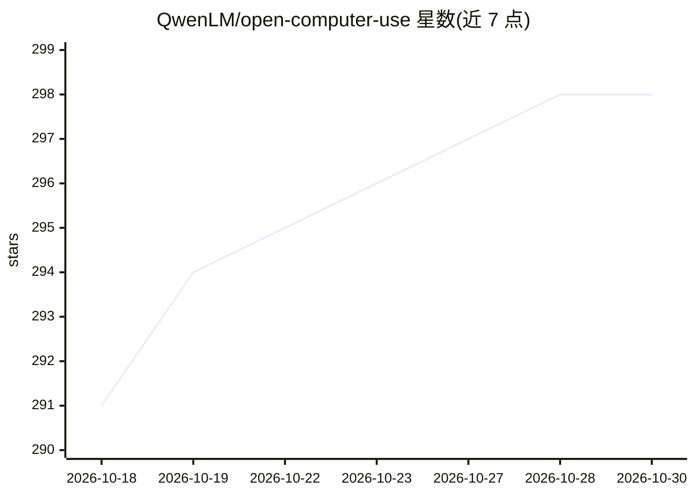

# QwenLM/open-computer-use

⭐ 298 · Swift · MIT · 推送 2026-06-10 · [GitHub](https://github.com/QwenLM/open-computer-use) · 组织维护 · 中文 README

**让 AI agent 通过 MCP 控制三平台电脑的计算机使用服务**

由 QwenLM 维护、基于 MCP stdio 的 Computer Use 服务，向 Qwen Code 及任意 MCP 客户端提供 9 个计算机操作工具，通过无障碍 API 控制 macOS、Linux 与 Windows（分别基于 SCScreenshotManager/AT-SPI/UI Automation）。macOS 需一次性授予辅助功能与屏幕录制权限。提供 CLI 诊断与单工具调用命令，macOS 截图大小/质量可用环境变量调节且坐标精度在缩放后保持。系 iFurySt/open-codex-computer-use 的跨平台 fork，以 npm 包分发。

## 筛选速览

| 维度 | 判定 | 备注 |
|---|---|---|
| AI 角色 | `ai-ecosystem` | LLM/agent 周边工具 |
| 许可风险 | `permissive` | MIT |
| 部署形态 | `library` | 以包/库形式分发 |
| 模型依赖 | — | README 未给出锁定关系 |
| 硬件要求 | — | 无带数字的原话,不猜 |
| 安装摩擦 | `low` | 无编译、无系统依赖或容器化 |
| 成熟度 | — | 结构信号不足 |

## 能力要点

- MCP stdio 传输，含 9 个 Computer Use 工具
- 跨 macOS/Linux/Windows 三平台无障碍 API 控制
- CLI 提供 doctor/call/snapshot/list-apps 命令
- macOS 截图大小/质量经环境变量调节且坐标精度保持

## 适用场景

- 为 Qwen Code 等 MCP 客户端接入桌面自动化能力
- 诊断或脚本化调用单个计算机操作工具
- 控制截图体积以适配模型输入限制

## 场景标签

`GUI 自动化` · 领域:效率与自动化

## 证据(README 行号)

> L6: MCP-based Computer Use service for Qwen Code and any MCP client — controls macOS, Linux, and Windows via accessibili
> L71: - **MCP server**: Full MCP stdio transport with 9 Computer Use tools

## 星数曲线

2026-10-18 291 → 2026-10-30 298（+7）

---
*卡片 v1 · prompt 1.4 · 生成 2026-10-21 · 置信度 high · 依据 README sha `3720cc63e24c` · [字段定义](../../DATASET.md)*
