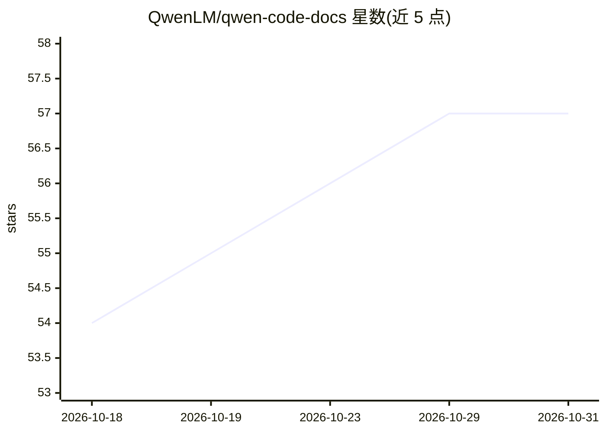

# QwenLM/qwen-code-docs

⭐ 57 · MDX · 推送 2026-10-29 · [GitHub](https://github.com/QwenLM/qwen-code-docs) · [官网](https://qwenlm.github.io/qwen-code-docs/) · 组织维护 · 中文 README

**面向 Qwen Code 的文档翻译工具：同步 GitHub 文档并用 Qwen AI 多语言翻译**

为 Qwen Code 仓库设计的文档翻译工具：从 GitHub 源仓库同步 Markdown 文档，调用 OpenAI 兼容 API（默认 Qwen 模型）翻译为中文、德语、法语等 8 种语言，并基于 Nextra/Next.js 生成多语言文档站点。提供 CLI 命令：init 初始化、sync 增量同步与翻译、markdown/meta 翻译指定文件、status 查看状态。翻译时保留代码块、链接与技术术语，支持并行处理多语言。检测/仅同步源文档模式无需 API key；通过 npm 全局安装，需 Node.js >= 18。

## 筛选速览

| 维度 | 判定 | 备注 |
|---|---|---|
| AI 角色 | `ai-native` | 本体是模型或模型工具 |
| 许可风险 | `none` | — |
| 部署形态 | `library` | 以包/库形式分发 |
| 模型依赖 | — | README 未给出锁定关系 |
| 硬件要求 | — | 无带数字的原话,不猜 |
| 安装摩擦 | `low` | 无编译、无系统依赖或容器化 |
| 成熟度 | — | 结构信号不足 |

## 能力要点

- GitHub 文档自动同步与变更检测增量翻译
- 支持 8 种目标语言并行翻译，保留代码块与技术术语
- 基于 Nextra 生成多语言文档站点，支持语言切换
- 兼容 OpenAI 兼容端点，可切换 DashScope 等服务

## 适用场景

- 为开源项目文档维护多语言翻译并自动跟进上游更新
- 为 Qwen Code 等仓库生成可切换语言的多语言文档站
- 仅检测文档变更而不消耗翻译 API 调用

## 场景标签

`AI 写作` `工作流自动化` · 领域:效率与自动化

## 证据(README 行号)

> L3: A documentation translation tool specifically designed for the github project. Automatically sync documentation from
> L8: - 🤖 **Qwen AI Translation**: Powered by Qwen API for high-quality technical document translation
> L145: 3. **Translate**: Content is segmented and translated using Qwen AI, with smart handling of code blocks and techni

## 星数曲线

2026-10-18 54 → 2026-10-31 57（+3）

---
*卡片 v1 · prompt 1.4 · 生成 2026-10-24 · 置信度 high · 依据 README sha `31ac3dddb8d6` · [字段定义](../../DATASET.md)*
