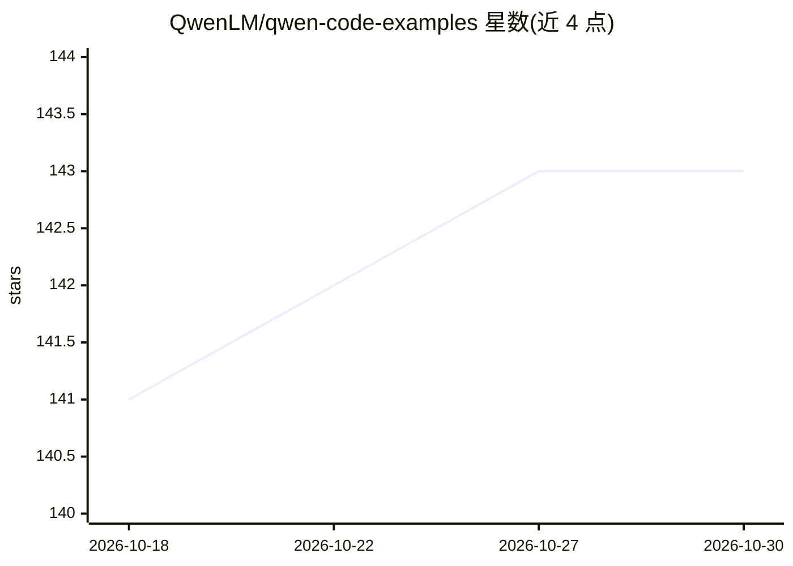

# QwenLM/qwen-code-examples

⭐ 143 · TypeScript · 推送 2026-05-19 · [GitHub](https://github.com/QwenLM/qwen-code-examples) · 组织维护 · 中文 README

**Qwen Code 实用示例与最佳实践合集（技能/扩展/SDK）**

面向开发者的 Qwen Code 示例仓库，收录四类内容：定制命令、扩展、技能（如 YouTube 字幕提取、DashScope 图像生成、自动 PR、全栈仪表盘构建）与 SDK 集成代码片段；另含五个基于 Qwen Code SDK 的生产级演示应用（面向产品经理、设计师、办公人员、内容创作者、视频创作者）。通过 git clone 获取，各技能依赖其目录内 SKILL.md 描述的安装步骤；Python 或 Node.js 技能需相应运行时，部分技能需 DASHSCOPE_API_KEY 等 API key。

## 筛选速览

| 维度 | 判定 | 备注 |
|---|---|---|
| AI 角色 | `ai-knowledge` | 知识聚合/清单类 |
| 许可风险 | `none` | — |
| 部署形态 | `None` |  |
| 模型依赖 | — | README 未给出锁定关系 |
| 硬件要求 | — | 无带数字的原话,不猜 |
| 安装摩擦 | `low` | 无编译、无系统依赖或容器化 |
| 成熟度 | — | 结构信号不足 |

## 能力要点

- 四类示例：自定义命令/扩展/技能/SDK 用法
- 五个基于 Qwen Code SDK 的生产级演示应用
- 特色技能：自动 PR、图像生成、仪表盘构建、YouTube 字幕提取

## 适用场景

- 为 Qwen Code 查找可复用的技能与扩展实现
- 参考 SDK 代码片段将 Qwen Code 集成到自己的项目
- 基于演示应用快速搭建原型或办公助手

## 场景标签

`精选清单` · 领域:学习与行业

## 证据(README 行号)

> L3: This repository contains a collection of practical examples and best practices for **Qwen Code**, designed to help d
> L10: - **SDK Usage**: Practical code snippets showing how to integrate Qwen Code SDKs into your projects.

## 星数曲线

2026-10-18 141 → 2026-10-30 143（+2）

---
*卡片 v1 · prompt 1.4 · 生成 2026-10-22 · 置信度 high · 依据 README sha `836459819b99` · [字段定义](../../DATASET.md)*
