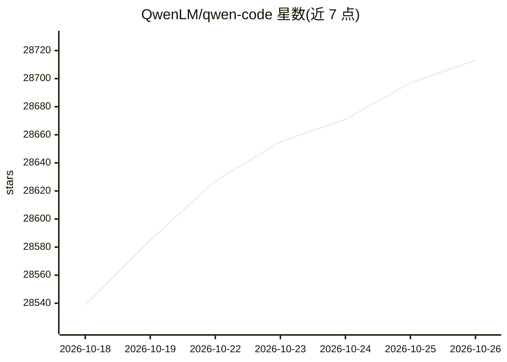

# QwenLM/qwen-code

⭐ 28,713 · TypeScript · Apache-2.0 · 推送 2026-10-25 · [GitHub](https://github.com/QwenLM/qwen-code) · [官网](https://qwenlm.github.io/qwen-code-docs/en/users/overview) · 组织维护 · 中文 README

**面向开发者的终端 AI 编码 agent，支持多模型多界面**

开源命令行 AI 编码 agent，提供终端、桌面应用、Web UI、编辑器插件与 IM 渠道等多种使用界面。内置 SubAgents、Agent Teams、Auto-Memory、Auto-Skills 与 MCP 支持，支持 OpenAI、Anthropic、Gemini、Qwen 协议及第三方本地模型，可在运行时切换。通过 npm、Homebrew 或安装脚本部署，需 Node.js 22+（npm 路径）。README 提供 SWE-bench Verified 评测数据（76.40%–77.80%）。

## 筛选速览

| 维度 | 判定 | 备注 |
|---|---|---|
| AI 角色 | `ai-native` | 本体是模型或模型工具 |
| 许可风险 | `permissive` | Apache-2.0 |
| 部署形态 | `library` | 以包/库形式分发 |
| 模型依赖 | local-ok | 支持本地模型 |
| 硬件要求 | — | 无带数字的原话,不猜 |
| 安装摩擦 | `low` | 无编译、无系统依赖或容器化 |
| 成熟度 | — | 结构信号不足 |

## 动量与使用信号

- 维护:`active` — 距上次 push 0.6 天,年发版 100,420 位贡献者
- 涨星:近 1 天 **+23**(自 20261016 起算)
- 安装:npm 包 `@qwen-code/qwen-code` 月下载 320,024
- 平台:WINDOWS / MACOS / LINUX / WEB · 协议:MCP / OLLAMA

## 能力要点

- 支持多协议模型接入：OpenAI/Anthropic/Gemini/Qwen API 及 Ollama/vLLM 本地模型
- 多种使用界面：终端、桌面、Web UI、VS Code/Zed/JetBrains 插件、Telegram/钉钉/微信/飞书渠道
- Headless 模式可嵌入脚本、CI/CD 与批处理，另提供 TypeScript/Python/Java SDK
- Agent Arena 支持多模型在同一任务上对比运行

## 适用场景

- 在终端里用自然语言让 AI 阅读、解释和修改项目代码
- 在 CI/CD 或脚本中以 headless 模式自动执行编码任务
- 通过 IM 渠道（如飞书/钉钉）远程调用编码 agent

## 场景标签

`编码 Agent` · 领域:编码与开发

## 证据(README 行号)

> L8: **The open-source AI coding agent for your terminal, editor, desktop, browser, and chat.**
> L24: - **Multi-protocol** — Supports OpenAI, Anthropic, Gemini, and Qwen APIs. Any third-party provider or local model (
> L112: |Feature|Qwen Code|Claude Code|

## 星数曲线

2026-10-18 28,539 → 2026-10-26 28,713（+174）

---
*卡片 v1 · prompt 1.4 · 生成 2026-10-18 · 置信度 high · 依据 README sha `a68fd51d23a4` · [字段定义](../../DATASET.md)*
