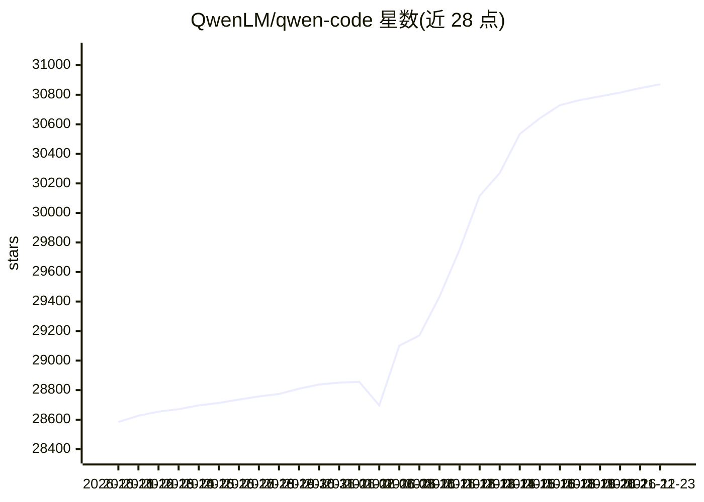

# QwenLM/qwen-code

⭐ 30,871 · TypeScript · Apache-2.0 · 推送 2026-11-22 · [GitHub](https://github.com/QwenLM/qwen-code) · [官网](https://qwenlm.github.io/qwen-code-docs/en/users/overview) · 组织维护 · 中文 README

**面向开发者的终端 AI 编码代理 CLI**

Qwen Code 是一个开源 AI 编码代理，主形态为终端 CLI，另提供桌面应用、Web UI、IDE 插件（VS Code/Zed/JetBrains）与聊天渠道集成（Telegram/钉钉/微信/飞书等）。内置 SubAgents、Agent Teams、Auto-Memory、Skills、MCP、Hooks、沙箱与 Git worktree 等机制，支持 headless 模式、daemon 模式（HTTP+SSE）以及 TypeScript/Python/Java SDK。支持 OpenAI/Anthropic/Gemini/Qwen API 及本地模型（Ollama/vLLM），可在运行时切换。安装依赖 Node.js 22+。

## 筛选速览

| 维度 | 判定 | 备注 |
|---|---|---|
| AI 角色 | `ai-native` | 本体是模型或模型工具 |
| 许可风险 | `permissive` | Apache-2.0 |
| 部署形态 | `library` | 以包/库形式分发 |
| 模型依赖 | local-ok | 支持本地模型 |
| 硬件要求 | — | 无带数字的原话,不猜 |
| 安装摩擦 | `low` | 无编译、无系统依赖或容器化 |
| 成熟度 | — | 结构信号不足 |

## 动量与使用信号

- 维护:`active` — 距上次 push 0.6 天,年发版 100,420 位贡献者
- 涨星:近 1 天 **+23**(自 20261016 起算)
- 安装:npm 包 `@qwen-code/qwen-code` 月下载 320,024
- 平台:WINDOWS / MACOS / LINUX / WEB · 协议:MCP / OLLAMA

## 能力要点

- 终端 CLI 为主，另有桌面、Web UI、IDE 插件与 IM 渠道等多种接口
- 内置 SubAgents、Agent Teams、Auto-Memory、Skills 的 agent 框架
- 多协议接入 OpenAI/Anthropic/Gemini/Qwen API 与本地模型，运行时可切换
- daemon 模式提供 HTTP+SSE API，支持多 workspace 与会话重连

## 适用场景

- 在终端中用自然语言完成代码审查、修复与批量修改
- 在 CI/CD 脚本中通过 headless 模式运行编码任务
- 接入 MCP 服务器扩展工具并通过 IDE 插件协同编码
- 用本地模型（Ollama/vLLM）作为后端运行编码代理

## 场景标签

`编码 Agent` `代码审查` · 领域:编码与开发

## 证据(README 行号)

> L8: **The open-source AI coding agent for your terminal, editor, desktop, browser, and chat.**
> L26: - **Agentic out of the box** — Auto-Memory, Skills, SubAgents, and MCP work from the first session. Agent Teams, Ag
> L138: Qwen Code ships with a complete agent harness — multi-agent orchestration, persistent memory, and deep extensibili

## 星数曲线

2026-10-21 28,585 → 2026-11-23 30,871（+2,286）

---
*卡片 v1 · prompt 1.4 · 生成 2026-11-22 · 置信度 high · 依据 README sha `e26b80d2218f` · [字段定义](../../DATASET.md)*
