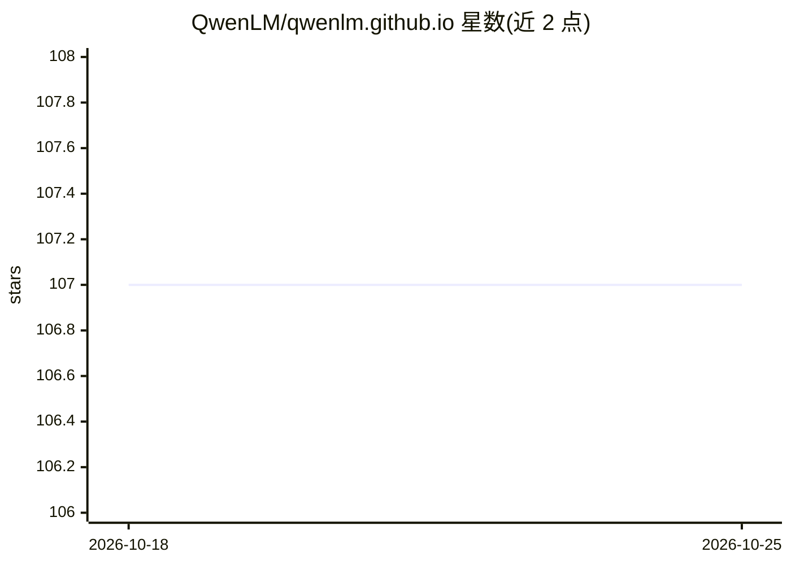

# QwenLM/qwenlm.github.io

⭐ 107 · HTML · 推送 2026-01-21 · [GitHub](https://github.com/QwenLM/qwenlm.github.io) · [官网](https://qwen.ai/research) · 组织维护 · 中文 README

**Qwen 团队博客仓库：已停止更新，转向 qwen.ai**

QwenLM 组织托管的 Qwen 博客静态站点仓库，内容为团队研究动态与新闻。README 明确声明该博客不再更新，最新内容迁移至 qwen.ai/research。仓库本身仅含说明与跳转指引，不含工具、代码或数据集，属于团队官方信息发布渠道的存档形态。

## 筛选速览

| 维度 | 判定 | 备注 |
|---|---|---|
| AI 角色 | `ai-knowledge` | 知识聚合/清单类 |
| 许可风险 | `none` | — |
| 部署形态 | `None` |  |
| 模型依赖 | — | README 未给出锁定关系 |
| 硬件要求 | — | 无带数字的原话,不猜 |
| 安装摩擦 | `low` | 无编译、无系统依赖或容器化 |
| 成熟度 | — | 结构信号不足 |

## 能力要点

- Qwen 团队官方博客静态站点仓库
- README 声明博客已停止更新
- 指向 qwen.ai/research 作为最新动态来源

## 适用场景

- 查看 Qwen 团队历史研究动态与新闻存档
- 追踪 Qwen 官方最新发布需转至 qwen.ai

## 场景标签

 · 领域:大模型团队官方信息发布

## 证据(README 行号)

> L1: # Qwen's Blog
> L4: > This blog is no longer being updated. For the latest news, please visit qwen.ai.

## 星数曲线

2026-10-18 107 → 2026-10-25 107（+0）

---
*卡片 v1 · prompt 1.4 · 生成 2026-10-23 · 置信度 high · 依据 README sha `d2e7207d9a4c` · [字段定义](../../DATASET.md)*
