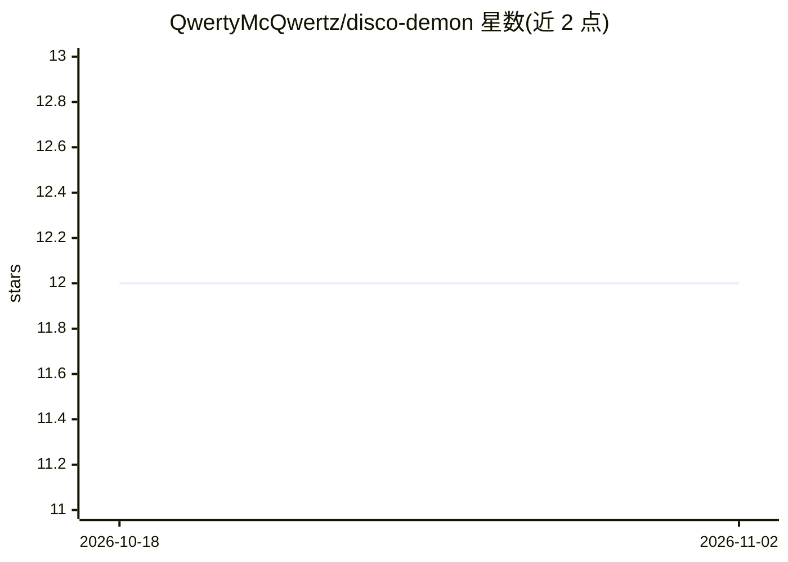

# QwertyMcQwertz/disco-demon

⭐ 12 · TypeScript · MIT · 推送 2026-02-02 · [GitHub](https://github.com/QwertyMcQwertz/disco-demon) · 个人维护

**通过 Discord 频道驱动 Claude Code 会话的守护进程**

面向开发者的 Discord 机器人守护进程：每个 Claude Code 会话对应一个 Discord 频道，频道内直接输入消息即发送到 tmux 中运行的 claude CLI，输出被解析、格式化后实时流回频道。支持图片分析、会话持久化与自动重连、tmux 终端接入、从 ClawHub/GitHub 安装技能（分 channel/disco/global 三级作用域）。README 明确安全警告：会话频道内任何人都可在宿主机执行任意命令，需在私有服务器配合用户白名单与路径限制使用。安装依赖 Node.js 18+、tmux 与 Claude Code CLI。

## 筛选速览

| 维度 | 判定 | 备注 |
|---|---|---|
| AI 角色 | `ai-ecosystem` | LLM/agent 周边工具 |
| 许可风险 | `permissive` | MIT |
| 部署形态 | `library` | 以包/库形式分发 |
| 模型依赖 | — | README 未给出锁定关系 |
| 硬件要求 | — | 无带数字的原话,不猜 |
| 安装摩擦 | `low` | 无编译、无系统依赖或容器化 |
| 成熟度 | — | 结构信号不足 |

## 能力要点

- 每个 Claude 会话对应独立 Discord 频道，消息直发 Claude、输出实时流回
- 会话基于 tmux 持久化，支持断线重连与 bot 重启后恢复
- 从 ClawHub 或 GitHub 安装技能，支持三级作用域（channel/disco/global）
- 提供用户白名单、路径限制等安全配置及 systemd/pm2/launchd 服务化方案

## 适用场景

- 在 Discord 频道里与 Claude Code 持续对话完成编码任务
- 团队私有服务器上通过频道隔离管理多个 Claude 工作会话
- 让 Claude 按需安装技能，经 confirm/cancel 确认

## 场景标签

`编码 Agent` · 领域:编码与开发

## 证据(README 行号)

> L5: Discord + Claude Code Daemon with persistent sessions.
> L205: 2. Disco Demon sends your message to a tmux session running `claude`
> L285: - Discord messages → `tmux send-keys` → Claude CLI

## 星数曲线

2026-10-18 12 → 2026-11-02 12（+0）

---
*卡片 v1 · prompt 1.4 · 生成 2026-11-01 · 置信度 high · 依据 README sha `09fb159d4a1a` · [字段定义](../../DATASET.md)*
