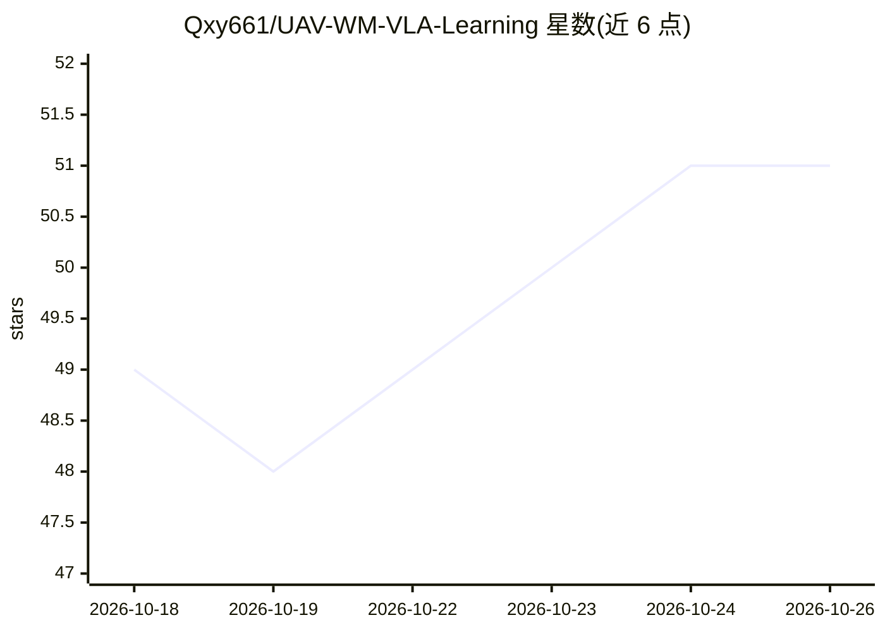

# Qxy661/UAV-WM-VLA-Learning

⭐ 51 · Python · MIT · 推送 2026-10-25 · [GitHub](https://github.com/Qxy661/UAV-WM-VLA-Learning) · [官网](https://qxy661.github.io/UAV-WM-VLA-Learning/) · 个人维护 · 中文 README

**无人机视角的世界模型/VLA/VLM 学习库：59 篇文档+195 篇论文精读**

面向零基础到科研入门的学习知识库：以通用世界模型/VLA/VLM 方法为主干、无人机作为贯穿 9 卷的专章，提供 59 篇学习文档（含阅读时间、思考题、推荐度分级）、195 篇论文分类精读与三卷自测题。关键结论配 24 个纯 CPU 可跑的验证 demo（仅依赖 numpy+matplotlib，合计约 16 分钟），另有 17 个可单机复现的无人机 AI 项目指南与 arXiv 增量追踪台账。硬件边界为单张 8 GB 显卡，不训大模型。支持 git clone 本地运行与 GitHub Pages 在线阅读。

## 筛选速览

| 维度 | 判定 | 备注 |
|---|---|---|
| AI 角色 | `ai-knowledge` | 知识聚合/清单类 |
| 许可风险 | `permissive` | MIT |
| 部署形态 | `library` | 以包/库形式分发 |
| 模型依赖 | — | README 未给出锁定关系 |
| 硬件要求 | — | 无带数字的原话,不猜 |
| 安装摩擦 | `medium` | 含编译或系统依赖之一 |
| 成熟度 | — | 结构信号不足 |

## 能力要点

- 59 篇文档 + 195 篇论文分类精读，无人机专章贯穿 9 卷
- 24 个纯 CPU 可跑 demo，仅依赖 numpy+matplotlib，每脚本验证一条结论
- tools/watch.py 按月产出三卷前沿增量台账
- 三卷专题自测与 17 个可单机复现项目指南

## 适用场景

- 系统学习世界模型/VLA/VLM 并了解无人机方向的特殊性
- 按专题精读关键论文并追踪 arXiv 前沿增量
- 跑迷你 demo 验证正文结论，动手复现无人机 AI 项目

## 场景标签

`教程课程` · 领域:学习与行业

## 证据(README 行号)

> L48: |**论文精读**|195 篇关键论文分类精读，见 `references/paper-list.md`|
> L118: `docs/` 下共 59 篇学习文档，另有 4 篇思维导图与 6 篇参考资料。推荐度：★★★ 必读 · ★★☆ 推荐 · ★☆☆ 了解。
> L237: |完整论文列表|195 篇论文分类汇总|

## 星数曲线

2026-10-18 49 → 2026-10-26 51（+2）

---
*卡片 v1 · prompt 1.4 · 生成 2026-10-24 · 置信度 mid · 依据 README sha `bca0bb5ac697` · [字段定义](../../DATASET.md)*
