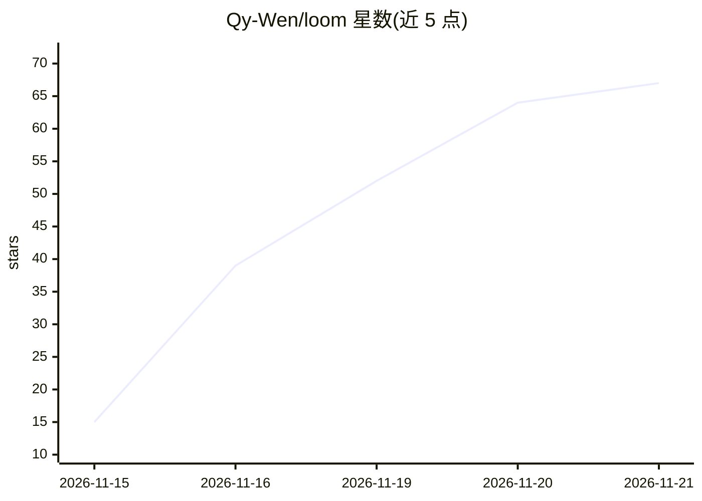

# Qy-Wen/loom

⭐ 67 · TypeScript · MIT · 推送 2026-11-20 · [GitHub](https://github.com/Qy-Wen/loom) · [官网](https://loom.sanzang.site) · 个人维护 · 中文 README

**本地优先的素材库桌面应用：用对话浏览、搜索和整理文件**

Electron 桌面应用，把本地文件夹变为素材库：浏览预览图片/视频/音频/PDF，用标签、收藏、自定义表格字段与引用/衍生关系链管理资产。AI 部分为聊天 Agent（整理、重命名、FFmpeg 剪辑压缩、批量更新表格）、语义搜索（Embedding/VLM/Audio 槽位配置模型端点）与 MCP 对外服务，可连接 ComfyUI 等工具；文件本体保留在原文件夹，元数据存于 .loom/ 目录。面向 AI 创作者、视频剪辑、摄影、设计等用户；需 Node.js≥22.19.0 与 pnpm 从源码运行，或使用官网安装包；模型服务由用户自行配置与付费。

## 筛选速览

| 维度 | 判定 | 备注 |
|---|---|---|
| AI 角色 | `ai-enhanced` | 去掉 AI 部分产品仍成立 |
| 许可风险 | `permissive` | MIT |
| 部署形态 | `library` | 以包/库形式分发 |
| 模型依赖 | — | README 未给出锁定关系 |
| 硬件要求 | — | 无带数字的原话,不猜 |
| 安装摩擦 | `medium` | 含编译或系统依赖之一 |
| 成熟度 | — | 结构信号不足 |

## 能力要点

- 聊天 Agent 整理/重命名/转码文件，Basic 权限模式下改动需用户批准且运行于沙箱
- 语义搜索与媒体理解，模型端点可本地或远程（Embedding/VLM/Audio/Rerank 槽位）
- 引用与衍生链接追踪 AI 作品来源，标签/属性/关系随文件移动
- 本地 MCP 服务允许外部 agent 客户端检索与组织素材库

## 适用场景

- 管理大量 AI 生成图片、视频与参考资料，并追溯每个成品的来源
- 让 Agent 帮忙整理散乱文件夹、批量命名与归档
- 用一句话按语义查找多年积累的参考素材

## 场景标签

`语义搜索` · 领域:知识与检索

## 证据(README 行号)

> L5: A local-first AI workbench that turns your folders into an asset library you can browse, search, and work with throu
> L18: - **Let the agent tidy your files.** Ask it to sort, rename, and regroup a messy folder, such as filing by type or 
> L20: - **Find years of references in a sentence.** Keep your folders as they are. Describe and index the assets you want

## 星数曲线

2026-11-15 15 → 2026-11-21 67（+52）

---
*卡片 v1 · prompt 1.4 · 生成 2026-11-18 · 置信度 mid · 依据 README sha `41187a9082eb` · [字段定义](../../DATASET.md)*
