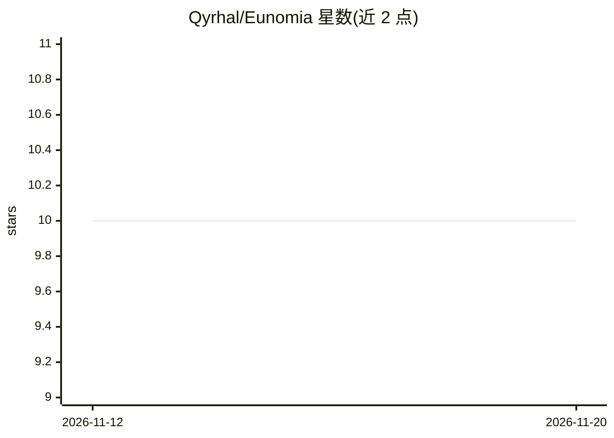

# Qyrhal/Eunomia

⭐ 10 · Rust · MIT · 推送 2026-10-24 · [GitHub](https://github.com/Qyrhal/Eunomia) · [官网](https://midhunkumar05.github.io/eunomia/) · 个人维护

**给 AI agent 的自托管记忆库：vault 化存储与跨会话回忆**

Eunomia 是一个自托管的 AI 记忆服务，以 vault 为单位为个人、项目或团队分别存储实体、记忆与关系，agent 通过 MCP 或 REST 读写。检索融合语义搜索、关键词、记忆文本、图链接与日期范围五条路径，用 RRF 合并。Rust 后端 + SurrealDB 存储，提供 Next.js 网页界面；内置 12 种数据源连接器，安装脚本依赖 Docker Compose。默认无需模型 key 即可做文本/图回忆，语义搜索等需配置 OpenAI 兼容端点且嵌入需返回 1,536 维向量。

## 筛选速览

| 维度 | 判定 | 备注 |
|---|---|---|
| AI 角色 | `ai-ecosystem` | LLM/agent 周边工具 |
| 许可风险 | `permissive` | MIT |
| 部署形态 | `self-host` | docker 或自建部署 |
| 模型依赖 | — | README 未给出锁定关系 |
| 硬件要求 | — | 无带数字的原话,不猜 |
| 安装摩擦 | `low` | 无编译、无系统依赖或容器化 |
| 成熟度 | — | 结构信号不足 |

## 能力要点

- vault 作为隔离与共享单元，支持创建/分享/克隆/合并
- 五路检索经 RRF 融合，跨会话回忆
- 12 种内置数据源连接器（GitHub、Slack、Gmail、Stripe 等）
- 每 org 独立数据库，token 可按 vault 限定与过期

## 适用场景

- 让 agent 在多次会话间保留项目与客户的上下文
- 团队共享一份可被 agent 读取的知识库
- 把 GitHub/Slack/Notion 等应用数据与 agent 记忆一起检索

## 场景标签

`Agent 记忆` `知识图谱` · 领域:Agent 开发

## 证据(README 行号)

> L24: Eunomia is a self-hosted memory service built around **vaults**: separate
> L25: spaces for the knowledge your agents read and update over MCP or REST.
> L156: The MCP endpoint is `<your Eunomia URL>/mcp`. Agents authenticate with a

## 星数曲线

2026-11-12 10 → 2026-11-20 10（+0）

---
*卡片 v1 · prompt 1.4 · 生成 2026-11-20 · 置信度 high · 依据 README sha `4b1617ae648e` · [字段定义](../../DATASET.md)*
