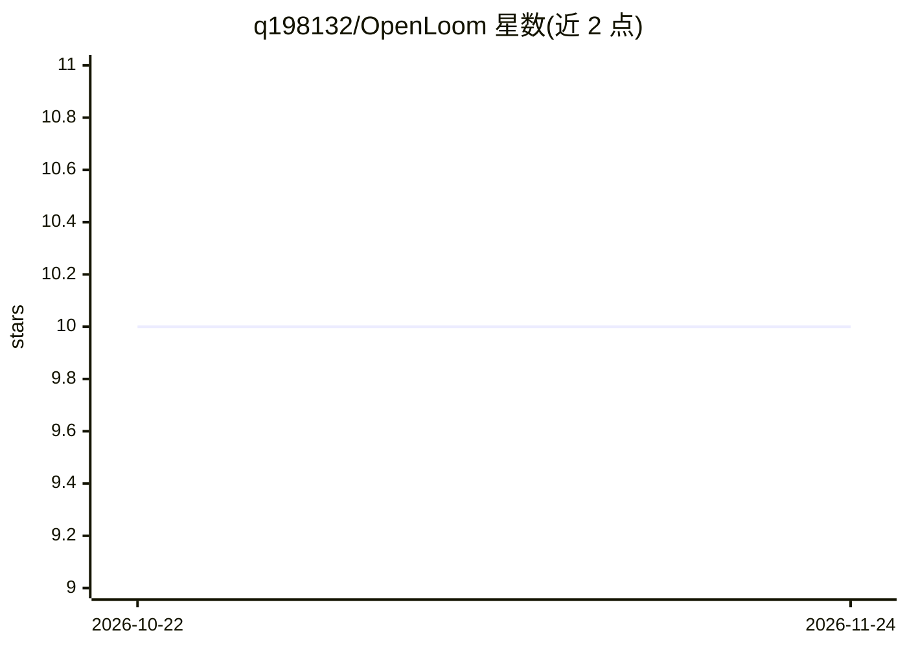

# q198132/OpenLoom

⭐ 10 · TypeScript · MIT · 推送 2026-05-19 · [GitHub](https://github.com/q198132/OpenLoom) · 个人维护 · 中文 README

**轻量桌面代码编辑器：看代码管 Git，写码交给终端 AI**

基于 Tauri 2.0（Rust 后端 + React 前端）的桌面代码编辑器，定位为终端 AI 编码工具的配套界面：Monaco Editor 编辑、内置 PTY 终端（可运行 Claude Code/OpenCode）、文件树、Git 管理、全局搜索、Diff 审查、SSH 远程开发与工作区切换。AI 功能包括通过 OpenAI 兼容 API 自动生成 commit message，以及在终端中配合 Claude Code/OpenCode 工作流。提供 Windows/macOS/Linux 安装包，开发者可从源码构建。

## 筛选速览

| 维度 | 判定 | 备注 |
|---|---|---|
| AI 角色 | `ai-enhanced` | 去掉 AI 部分产品仍成立 |
| 许可风险 | `permissive` | MIT |
| 部署形态 | `desktop` | 安装包/桌面程序 |
| 模型依赖 | local-ok | 支持本地模型 |
| 硬件要求 | — | 无带数字的原话,不猜 |
| 安装摩擦 | `low` | 无编译、无系统依赖或容器化 |
| 成熟度 | — | 结构信号不足 |

## 能力要点

- Monaco Editor + 内置 PTY 终端（xterm.js + portable-pty，多标签）
- Git 全流程管理：暂存、提交、Push/Pull/Sync、提交历史图
- Diff 审查 AI 生成的代码变更，支持按文件接受/拒绝
- SSH 远程开发：远程文件浏览/编辑、远程终端与 Git

## 适用场景

- 配合 Claude Code/OpenCode 写代码，用 OpenLoom 审 Diff 提交
- 需要轻量编辑器查看代码和管理 Git 提交
- 通过 SSH 在远程服务器上浏览和编辑代码

## 场景标签

`编码 Agent` · 领域:编码与开发

## 证据(README 行号)

> L30: 在 AI Coding 时代，Claude Code、OpenCode 等终端 AI 工具已经能帮你写代码、改 Bug、做重构。**你真正需要的不再是一个臃肿的全功能 IDE，而是一个轻量的界面来做两件事：看代码和管 Git。**
> L34: 它是一个基于 **Tauri 2.0** 的**轻量级原生桌面应用**，Rust 后端 + React 前端，启动快、体积小、资源占用低。
> L63: - **AI 提交信息** — 基于暂存区 diff 自动生成语义化 commit message

## 星数曲线

2026-10-22 10 → 2026-11-24 10（+0）

---
*卡片 v1 · prompt 1.4 · 生成 2026-11-19 · 置信度 high · 依据 README sha `55b6049b76b2` · [字段定义](../../DATASET.md)*
