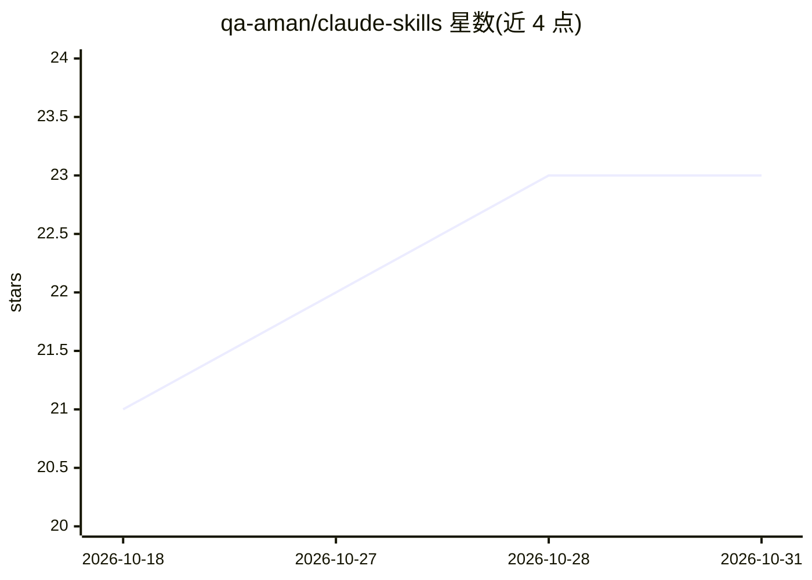

# qa-aman/claude-skills

⭐ 23 · Python · MIT · 推送 2026-10-19 · [GitHub](https://github.com/qa-aman/claude-skills) · 个人维护

**按职能组织的 Claude Code 技能合集（166 个技能、19 种角色）**

面向团队的 Claude Code 技能（Agent Skills）策展集合：166 个技能按 PM、QA、工程师、设计师、DevOps、领导力、客户成功、招聘等 19 种职能组织，每个技能对应一项打包工作流并注明所依据的方法论或书籍（如 Shape Up、SRE、Clean Code）。技能由 Claude 自动调用或以 /skill-name 命令触发。提供插件方式安装（可经 /plugin update 更新）或脚本安装到 .claude/skills/，支持全局与项目两种作用域。

## 筛选速览

| 维度 | 判定 | 备注 |
|---|---|---|
| AI 角色 | `ai-knowledge` | 知识聚合/清单类 |
| 许可风险 | `permissive` | MIT |
| 部署形态 | `None` |  |
| 模型依赖 | — | README 未给出锁定关系 |
| 硬件要求 | — | 无带数字的原话,不猜 |
| 安装摩擦 | `low` | 无编译、无系统依赖或容器化 |
| 成熟度 | — | 结构信号不足 |

## 能力要点

- 166 个技能覆盖 19 种职能角色
- 每个技能标注所依据的方法论或书籍来源
- 整体可作为 Claude Code 插件安装并经 /plugin update 更新
- 脚本按角色安装，支持全局（~/.claude/skills/）与项目作用域

## 适用场景

- 团队按职能挑选安装所需的 Claude Code 工作流技能
- 以 /claude-skills:write-prd 等命令触发 PRD、测试设计、代码评审等任务
- 统一团队项目内的技能约定（项目作用域安装）

## 场景标签

`工作流自动化` `精选清单` · 领域:效率与自动化

## 证据(README 行号)

> L10: A curated collection of Claude Code skills organized by job role. Each skill is a packaged workflow grounded in a p
> L12: **166 skills across 19 roles.** PM, QA, Engineer, Designer, DevOps, Leadership, Program Delivery, Customer Success,

## 星数曲线

2026-10-18 21 → 2026-10-31 23（+2）

---
*卡片 v1 · prompt 1.4 · 生成 2026-10-27 · 置信度 high · 依据 README sha `e11af5d29f02` · [字段定义](../../DATASET.md)*
