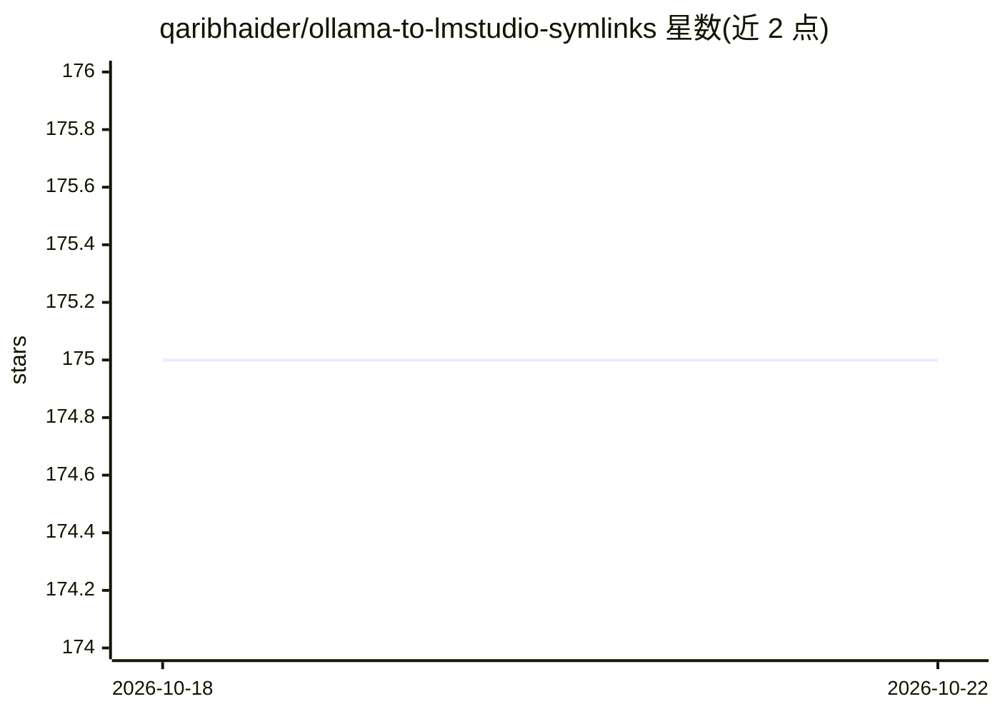

# qaribhaider/ollama-to-lmstudio-symlinks

⭐ 175 · Go · MIT · 推送 2026-09-21 · [GitHub](https://github.com/qaribhaider/ollama-to-lmstudio-symlinks) · 个人维护

**Ollama 与 LM Studio 模型共享的符号链接 CLI 工具**

Go 编写的跨平台命令行工具，通过符号链接（可选硬链接）在 Ollama 与 LM Studio 之间双向共享 GGUF 模型文件，避免重复占用磁盘空间。支持分片 GGUF（00001-of-0000N）分组链接、mmproj 多模态适配器配对、Hugging Face 命名空间，提供 status 统计去重节省空间、cleanup 清理断裂链接、delete 选择性删除等子命令，附交互式终端菜单。macOS/Linux/Windows 原生运行，Windows 可用 --hardlinks 回退。

## 筛选速览

| 维度 | 判定 | 备注 |
|---|---|---|
| AI 角色 | `ai-ecosystem` | LLM/agent 周边工具 |
| 许可风险 | `permissive` | MIT |
| 部署形态 | `desktop` | 安装包/桌面程序 |
| 模型依赖 | local-ok | 支持本地模型 |
| 硬件要求 | — | 无带数字的原话,不猜 |
| 安装摩擦 | `low` | 无编译、无系统依赖或容器化 |
| 成熟度 | — | 结构信号不足 |

## 能力要点

- Ollama ↔ LM Studio 双向模型链接，不复制权重文件
- 分片 GGUF 自动分组链接与 mmproj 多模态适配器配对
- status 子命令统计链接数、断裂链接与磁盘节省量
- cleanup 扫描两侧 blob 目录清理断裂幽灵链接

## 适用场景

- 同时使用 Ollama 和 LM Studio 的用户共享同一份模型权重
- 磁盘空间紧张时避免同一模型在两个应用中重复下载
- ollama rm 后清理 LM Studio 中残留的失效链接

## 场景标签

 · 领域:本地 LLM 基础设施

## 证据(README 行号)

> L3: A fast, cross-platform Go CLI to create symbolic links between **Ollama** and **LM Studio**, sharing models bidirect
> L50: ### 2. Link Ollama → LM Studio (Forward Mode)
> L60: Scans LM Studio GGUFs and registers them with Ollama:

## 星数曲线

2026-10-18 175 → 2026-10-22 175（+0）

---
*卡片 v1 · prompt 1.4 · 生成 2026-10-22 · 置信度 high · 依据 README sha `f0aacf7e97ce` · [字段定义](../../DATASET.md)*
