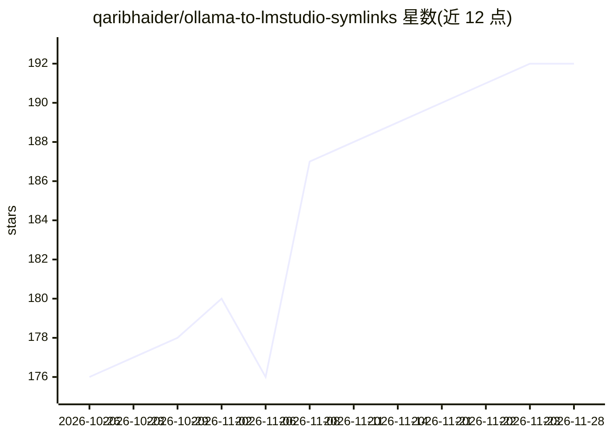

# qaribhaider/ollama-to-lmstudio-symlinks

⭐ 192 · Go · MIT · 推送 2026-11-21 · [GitHub](https://github.com/qaribhaider/ollama-to-lmstudio-symlinks) · 个人维护

**让 Ollama 与 LM Studio 通过符号链接共享模型、省磁盘的工具**

用 Go 编写的跨平台 CLI，在 Ollama 与 LM Studio 的模型目录间创建符号链接，实现模型双向共享而不复制文件。支持多分片 GGUF 的自动分组链接、多模态 mmproj 适配器配对、Hugging Face 命名空间模型；提供 status 统计去重节省的磁盘空间、cleanup 清理失效链接、delete 选择性删除。面向在本地同时使用两款推理工具的用户，可通过安装脚本或预编译二进制安装，Windows 下可用 --hardlinks 代替符号链接。

## 筛选速览

| 维度 | 判定 | 备注 |
|---|---|---|
| AI 角色 | `ai-ecosystem` | LLM/agent 周边工具 |
| 许可风险 | `permissive` | MIT |
| 部署形态 | `desktop` | 安装包/桌面程序 |
| 模型依赖 | local-ok | 支持本地模型 |
| 硬件要求 | — | 无带数字的原话,不猜 |
| 安装摩擦 | `low` | 无编译、无系统依赖或容器化 |
| 成熟度 | — | 结构信号不足 |

## 能力要点

- Ollama 与 LM Studio 模型目录双向符号链接，不复制权重文件
- 自动分组多分片 GGUF 并配对 mmproj 多模态适配器
- status 子命令统计失效链接与去重节省的磁盘空间
- cleanup/delete 安全清理与删除链接，不触碰原始模型文件

## 适用场景

- 本机同时使用 Ollama 和 LM Studio，避免同一模型存两份
- 从 Hugging Face 下载的 GGUF 模型注册进 Ollama 使用
- 清理 ollama rm 之后残留的失效链接
- Windows 下符号链接受限时用硬链接共享模型

## 场景标签

 · 领域:LLM 基础设施/本地模型管理

## 证据(README 行号)

> L3: A fast, cross-platform Go CLI to create symbolic links between **Ollama** and **LM Studio**, sharing models bidirect
> L7: - 🔄 **Bidirectional Linking**: Link Ollama models to LM Studio OR LM Studio models to Ollama.

## 星数曲线

2026-10-26 176 → 2026-11-28 192（+16）

---
*卡片 v1 · prompt 1.4 · 生成 2026-11-25 · 置信度 high · 依据 README sha `867e2b63b1e3` · [字段定义](../../DATASET.md)*
