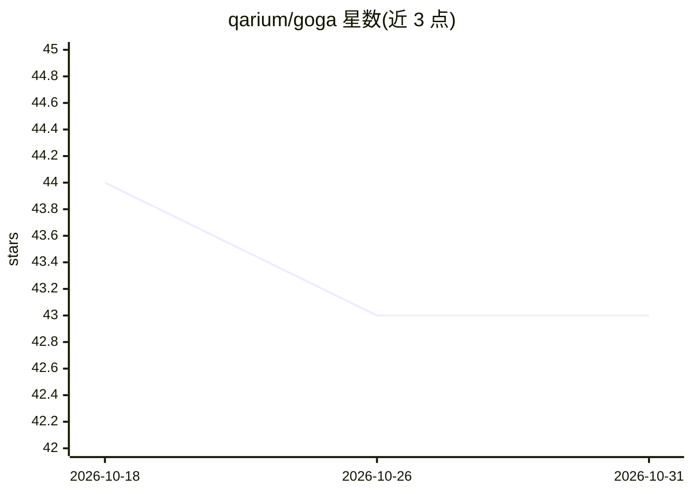

# qarium/goga

⭐ 43 · Python · BSD-3-Clause · 推送 2026-10-22 · [GitHub](https://github.com/qarium/goga) · 个人维护

**面向开发者的 AI-SDLC 平台：以流水线编排 CLI 编码 agent**

Goga 将软件工程流程声明为可复用的流水线：以 YAML 定义 specify→review→prototype→build→accept 等阶段，任一已安装的 CLI 编码 agent（Claude、Codex、Qwen、OpenCode、Cursor 等）可按阶段被雇佣执行，communication 检查点在自主与人审之间切换。能力打包为 goga-tool-* 插件，随箱提供基于 CODEMANIFEST 契约的 SDD 参考周期；goga build 在 Docker 容器内以 ralph-loop 将计划落地为代码。通过 pipx 安装，运行依赖 Docker。

## 筛选速览

| 维度 | 判定 | 备注 |
|---|---|---|
| AI 角色 | `ai-ecosystem` | LLM/agent 周边工具 |
| 许可风险 | `permissive` | BSD-3-Clause |
| 部署形态 | `self-host` | docker 或自建部署 |
| 模型依赖 | — | README 未给出锁定关系 |
| 硬件要求 | — | 无带数字的原话,不猜 |
| 安装摩擦 | `low` | 无编译、无系统依赖或容器化 |
| 成熟度 | — | 结构信号不足 |

## 能力要点

- YAML 声明式流水线，阶段可指定不同 agent 执行
- communication 检查点支持自主/人工介入切换
- goga build 在隔离 Docker 容器内将计划按任务序列物化为代码，CODEMANIFEST 保持只读
- goga-tool-* 插件包共享技能与流水线目录

## 适用场景

- 把 SDD 开发周期声明为可复现的流水线并在多个项目间共享
- 在不同阶段混用 Claude、Codex、Qwen 等编码 agent
- 为 agent 工作流设置人工审批检查点后自主运行

## 场景标签

`Agent 框架` · 领域:Agent 开发

## 证据(README 行号)

> L9: Goga turns engineering processes into reusable software. Define them as pipelines, package capabilities as tools, us
> L119: A **pipeline** is a declarative scenario of stages an agent walks through to deliver a piece of work — specify, re
> L248: `goga build` is a separate service that materializes a plan into code. Pipelines produce plans; Build executes the

## 星数曲线

2026-10-18 44 → 2026-10-31 43（-1）

---
*卡片 v1 · prompt 1.4 · 生成 2026-10-25 · 置信度 mid · 依据 README sha `a32b55af4464` · [字段定义](../../DATASET.md)*
