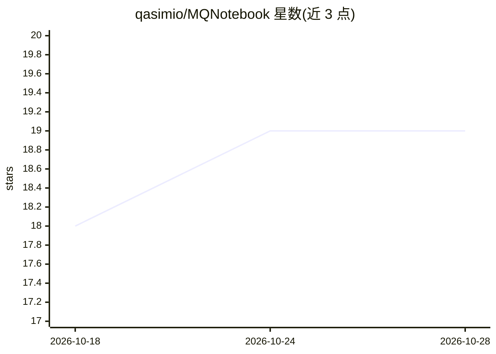

# qasimio/MQNotebook

⭐ 19 · Python · 推送 2026-06-10 · [GitHub](https://github.com/qasimio/MQNotebook) · [官网](https://mqnotebook.streamlit.app/) · 个人维护

**本地优先的企业级 RAG 文档问答引擎，处理扫描件与复杂办公文档**

面向企业杂乱文档的 RAG 系统：用 Tesseract OCR + Poppler 处理扫描 PDF 与图片，从 PPT 提取 SmartArt、图形与演讲者备注，逐行解析 Excel 保留列结构。检索层采用本地 CPU 运行的 BAAI/bge-small-en-v1.5 嵌入与 Cross-Encoder 重排器（top15 过滤到 top5），生成由 Gemini 2.0 Flash（经 OpenRouter）完成。以 Streamlit 应用形式提供，支持 Windows/Linux，Free 模式限 10 问/会话，Pro 模式自带 API key 无限使用。需本地安装 Tesseract 与 Poppler 并配置路径。

## 筛选速览

| 维度 | 判定 | 备注 |
|---|---|---|
| AI 角色 | `ai-native` | 本体是模型或模型工具 |
| 许可风险 | `none` | — |
| 部署形态 | `desktop` | 安装包/桌面程序 |
| 模型依赖 | locked-api |  |
| 硬件要求 | — | 无带数字的原话,不猜 |
| 安装摩擦 | `low` | 无编译、无系统依赖或容器化 |
| 成熟度 | — | 结构信号不足 |

## 能力要点

- Tesseract OCR + Poppler 兜底处理扫描 PDF 与图片
- PPT 提取 SmartArt/图形/演讲者备注，Excel 逐行解析保留结构
- 本地 bge-small 嵌入 + Cross-Encoder 重排（top15→top5）
- Free/Pro 双模式，Pro 模式 key 仅存会话内存

## 适用场景

- 对扫描件、表格、幻灯片等复杂企业文档做问答与语义检索
- 在本地或私有环境运行 RAG 流程处理敏感文档
- 无需自建 LLM 服务即可上手文档问答（Free 模式）

## 场景标签

`文档问答` `RAG` · 领域:知识与检索

## 证据(README 行号)

> L3: **MQNotebook** is a production-ready, local Retrieval-Augmented Generation (RAG) engine designed to handle the "mess
> L24: * **LLM:** **Gemini 2.0 Flash** (via OpenRouter) for massive context windows and fast reasoning.
> L26: * **Precision:** Includes a **Cross-Encoder Reranker**. The system retrieves the top 15 matches but filters them do

## 星数曲线

2026-10-18 18 → 2026-10-28 19（+1）

---
*卡片 v1 · prompt 1.4 · 生成 2026-10-28 · 置信度 high · 依据 README sha `fc35df0abc82` · [字段定义](../../DATASET.md)*
