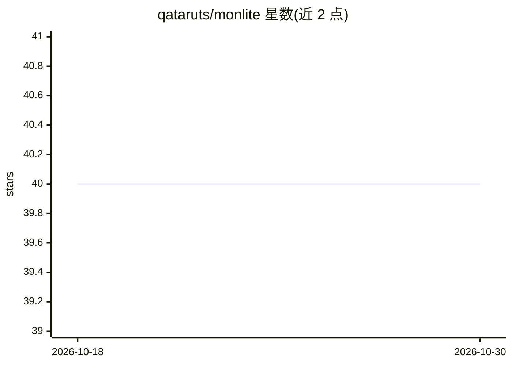

# qataruts/monlite

⭐ 40 · TypeScript · MIT · 推送 2026-07-13 · [GitHub](https://github.com/qataruts/monlite) · [官网](https://qataruts.github.io/monlite/) · 个人维护

**面向 AI agent 的嵌入式一体化后端：SQLite 单文件承载文档/向量/队列**

基于 SQLite 的 TypeScript 嵌入式文档数据库，提供 Mongo/Prisma 风格的类型化查询 API，并以插件形式在同一个 .db 文件上叠加全文检索、向量/混合搜索、KV 缓存与锁、持久化任务队列、cron 定时与实时 watch。面向需要记忆、语义检索与队列的 coding agent / RAG / 自治 worker 开发者。核心零依赖（Node 22.5+ 用内置 node:sqlite，无需原生编译），超出单文件时同一套 API 可切换到 Postgres 引擎；有 Python 移植（读写同一文件）与 Go 客户端。部分包为 0.x，API 可能变动。

## 筛选速览

| 维度 | 判定 | 备注 |
|---|---|---|
| AI 角色 | `ai-ecosystem` | LLM/agent 周边工具 |
| 许可风险 | `permissive` | MIT |
| 部署形态 | `self-host` | docker 或自建部署 |
| 模型依赖 | — | README 未给出锁定关系 |
| 硬件要求 | — | 无带数字的原话,不猜 |
| 安装摩擦 | `low` | 无编译、无系统依赖或容器化 |
| 成熟度 | `idea` | |

## 能力要点

- 单 SQLite 文件承载文档、向量、KV、队列、cron、实时 watch，零服务零迁移
- 同一套 API 可切换到 Postgres 引擎（含 pgvector、LISTEN/NOTIFY、SKIP LOCKED）
- Python/Go 端口与 Node 读写同一数据库，跨运行时互操作（经互操作测试）
- 全文+向量经 Reciprocal Rank Fusion 融合的混合搜索，宣称 100K 文档约 0.8s 完成索引

## 适用场景

- 为 coding agent / RAG 管线提供本地记忆、语义检索与任务队列
- CLI 或桌面应用想内嵌数据库而不起外部服务
- 本地开发用单文件、上线后换 Postgres 引擎且不改应用代码
- Python 负责入库/嵌入、Node 负责服务，共用同一个数据库文件

## 场景标签

`向量数据库` `Agent 记忆` · 领域:Agent 开发

## 证据(README 行号)

> L8: **An embedded document database for TypeScript — MongoDB's API, Prisma's DX, SQLite underneath —
> L22: A coding agent, RAG pipeline, or autonomous worker needs memory, semantic search, a job queue, and
> L33: Exactly-once job claims, locks, scheduling, and full-text + semantic search — with **no server, no

## 星数曲线

2026-10-18 40 → 2026-10-30 40（+0）

---
*卡片 v1 · prompt 1.4 · 生成 2026-10-25 · 置信度 mid · 依据 README sha `a1a08291eae3` · [字段定义](../../DATASET.md)*
