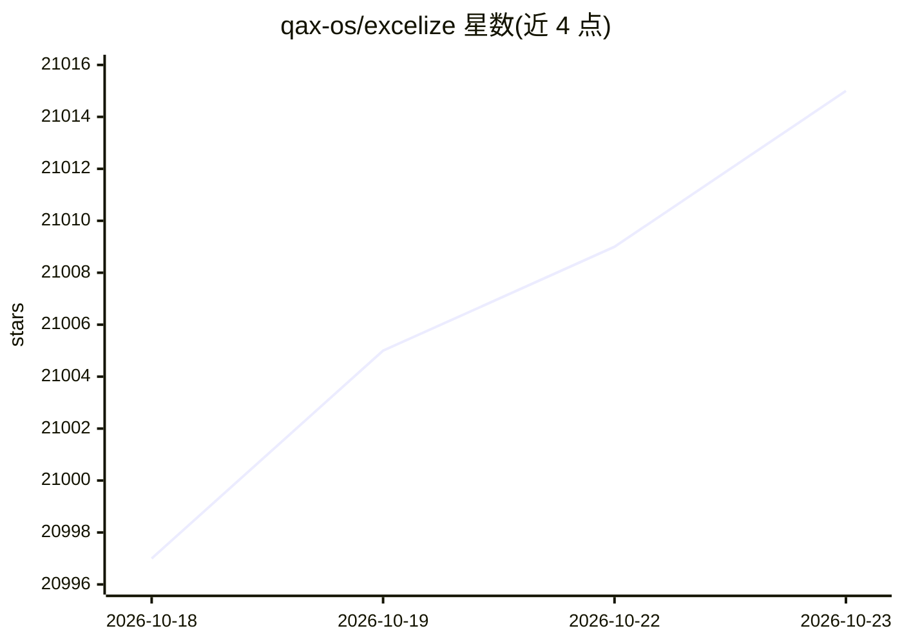

# qax-os/excelize

⭐ 21,015 · Go · BSD-3-Clause · 推送 2026-10-20 · [GitHub](https://github.com/qax-os/excelize) · [官网](https://xuri.me/excelize) · 组织维护

**给 Go 开发者的 Excel 读写库：操作 XLSX 等电子表格文件**

Excelize 是纯 Go 编写的库，提供读写 XLAM/XLSM/XLSX/XLTM/XLTX 电子表格文件的函数集合，支持 Microsoft Excel 2007 及以后版本生成的文档，要求 Go 1.26.0 或更高版本。README 展示的用法包括创建、读取电子表格，添加图表（可基于工作表数据或无数据生成），以及在文件中添加图片。提供流式 API 用于处理包含大量数据的工作表。通过 go get 安装，兼容 Go Modules，采用 BSD 3-Clause 许可证。

## 筛选速览

| 维度 | 判定 | 备注 |
|---|---|---|
| AI 角色 | `ai-ecosystem` | LLM/agent 周边工具 |
| 许可风险 | `permissive` | BSD-3-Clause |
| 部署形态 | `None` |  |
| 模型依赖 | — | README 未给出锁定关系 |
| 硬件要求 | — | 无带数字的原话,不猜 |
| 安装摩擦 | `low` | 无编译、无系统依赖或容器化 |
| 成熟度 | — | 结构信号不足 |

## 动量与使用信号

- 维护:`active` — 距上次 push 4.2 天,年发版 2,333 位贡献者
- 涨星:近 1 天 **+2**(自 20261016 起算)

## 能力要点

- 纯 Go 实现，读写 XLAM/XLSM/XLSX/XLTM/XLTX 文件
- 流式 API 支持生成或读取海量数据的工作表
- 图表生成与管理，可基于工作表数据或无数据构建
- 支持在电子表格中添加图片

## 适用场景

- 在 Go 程序中生成带图表和图片的 Excel 报表
- 读取处理包含大量数据的电子表格文件
- 与 Microsoft Excel 2007 及以后版本生成的文档交互

## 场景标签

 · 领域:办公文档处理

## 证据(README 行号)

> L13: Excelize is a library written in pure Go providing a set of functions that allow you to write to and read from XLAM
> L20: go get github.com/xuri/excelize
> L76: This program is under the terms of the BSD 3-Clause License. See https://opensource.org/licenses/BSD-3-Clause.

## 星数曲线

2026-10-18 20,997 → 2026-10-23 21,015（+18）

---
*卡片 v1 · prompt 1.4 · 生成 2026-10-18 · 置信度 high · 依据 README sha `a1281fe0f1fe` · [字段定义](../../DATASET.md)*
