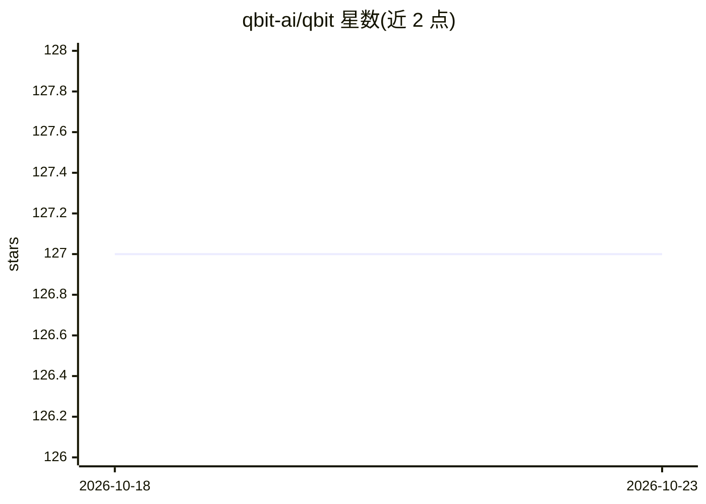

# qbit-ai/qbit

⭐ 127 · Rust · 推送 2026-03-26 · [GitHub](https://github.com/qbit-ai/qbit) · 组织维护

**开源 agentic 终端应用：在终端中对话、调用工具与 Git 集成**

基于 Rust/Tauri/React 构建的 macOS 与 Linux 桌面终端应用，面向开发者提供 AI agent 工作流：统一时间线中混合对话、工具结果与终端输出；支持多 AI 提供商与模型选择（自带 API key，无需账号订阅）、AI 生成内容的行内编辑、工具调用全透明展示、子 agent 执行视图与内置 Git 集成（diff 可视化）。macOS 经 Homebrew cask 安装，Linux 从 release 包或源码构建，并文档化 MCP 集成与 SWE-bench 评测。

## 筛选速览

| 维度 | 判定 | 备注 |
|---|---|---|
| AI 角色 | `ai-enhanced` | 去掉 AI 部分产品仍成立 |
| 许可风险 | `permissive` | — |
| 部署形态 | `None` |  |
| 模型依赖 | — | README 未给出锁定关系 |
| 硬件要求 | — | 无带数字的原话,不猜 |
| 安装摩擦 | `low` | 无编译、无系统依赖或容器化 |
| 成熟度 | — | 结构信号不足 |

## 能力要点

- 统一时间线整合 AI 对话、工具结果与终端输出
- 多 AI 提供商/模型选择，自带 key、无需账号
- 工具调用与子 agent 执行全程可见
- 内置 Git 集成与 diff 可视化

## 适用场景

- 在终端中以 agent 对话方式完成开发任务并审查工具调用
- 多提供商模型间切换进行编码辅助
- 在 AI 应用改动前先行内审查与编辑

## 场景标签

`编码 Agent` · 领域:编码与开发

## 证据(README 行号)

> L4: ## Open Source Agentic Terminal Application
> L30: Seamless conversation with AI, tool results, and terminal output
> L35: Choose from multiple AI providers and models

## 星数曲线

2026-10-18 127 → 2026-10-23 127（+0）

---
*卡片 v1 · prompt 1.4 · 生成 2026-10-23 · 置信度 mid · 依据 README sha `0d79aa69f64b` · [字段定义](../../DATASET.md)*
