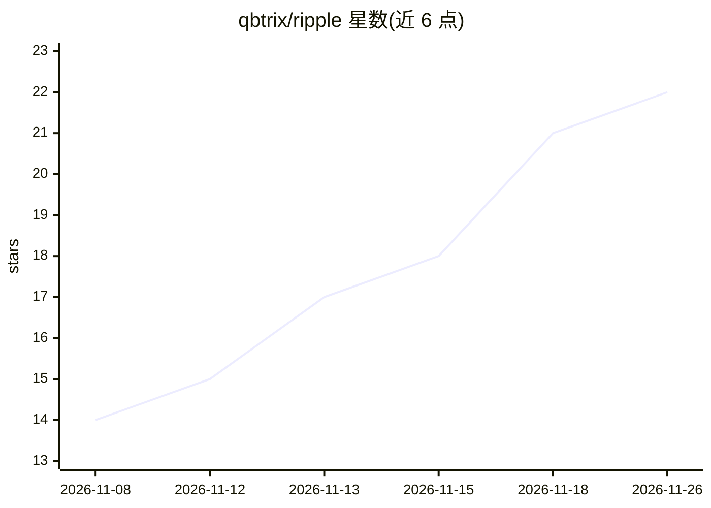

# qbtrix/ripple

⭐ 22 · TypeScript · MIT · 推送 2026-11-20 · [GitHub](https://github.com/qbtrix/ripple) · [官网](https://ripple.pocketpaw.xyz) · 组织维护

**生成式 UI 引擎：模型输出 JSON spec，边流式边渲染成可用界面**

面向开发者的开源生成式 UI 引擎：LLM 输出小型 JSON spec，Ripple 在 spec 流式传输过程中将其渲染为可用界面，保持状态、双向绑定输入、求值表达式、运行事件处理，并把 API 调用、导航、toast 等副作用交回宿主应用。包结构分为 core（无框架依赖的引擎与 headless 运行时）、Svelte 渲染器（215 个 widget）、embed 与 React 封装，另提供 MCP 服务器在聊天中内联渲染卡片，以及教 Claude Code/Codex/OpenCode 写 spec 的技能。React 路径无需 Svelte 或 Tailwind，Svelte 渲染器则要求 Tailwind v4。

## 筛选速览

| 维度 | 判定 | 备注 |
|---|---|---|
| AI 角色 | `ai-ecosystem` | LLM/agent 周边工具 |
| 许可风险 | `permissive` | MIT |
| 部署形态 | `library` | 以包/库形式分发 |
| 模型依赖 | — | README 未给出锁定关系 |
| 硬件要求 | — | 无带数字的原话,不猜 |
| 安装摩擦 | `low` | 无编译、无系统依赖或容器化 |
| 成熟度 | — | 结构信号不足 |

## 能力要点

- 流式渲染：首个 chunk 解析后显示骨架，随 token 到达逐步生长 UI
- 引擎/渲染器分离：core 无框架依赖，含 headless 运行时可在服务端解析 spec
- Svelte 渲染器提供 215 个 widget 与可视化编辑器
- 提供 MCP 服务器 ripple_render 在支持 MCP Apps 的聊天宿主中内联渲染卡片

## 适用场景

- 在我的聊天或 agent 应用中，让模型输出的界面 spec 实时渲染为可交互卡片
- 在 Svelte/React 项目中集成模型生成的动态表单与仪表盘
- 让 Claude Code 等编码 agent 编写并自审 Ripple spec 构建 UI
- 在服务端无 DOM 环境下解析与测试 UI spec

## 场景标签

`Agent 框架` · 领域:Agent 开发

## 证据(README 行号)

> L3: Open-source generative UI for your own app. A model writes a small JSON spec,
> L99: `@ripple-ui/mcp` is an MCP server with one tool,

## 星数曲线

2026-11-08 14 → 2026-11-26 22（+8）

---
*卡片 v1 · prompt 1.4 · 生成 2026-11-18 · 置信度 high · 依据 README sha `9ec8c237980c` · [字段定义](../../DATASET.md)*
