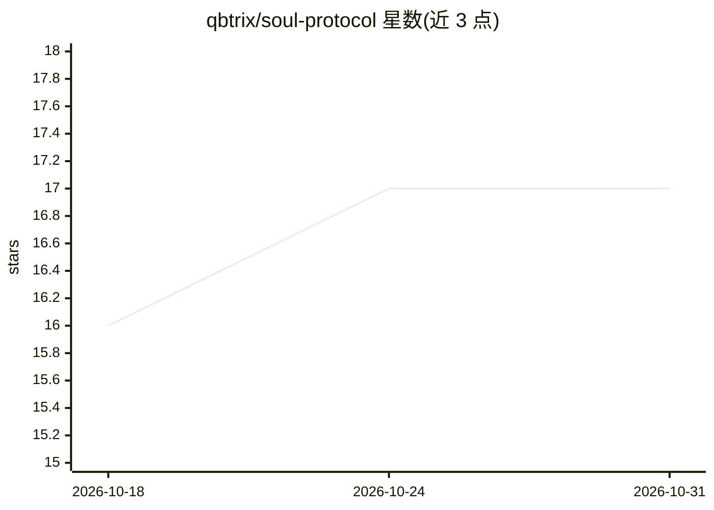

# qbtrix/soul-protocol

⭐ 17 · Python · MIT · 推送 2026-10-28 · [GitHub](https://github.com/qbtrix/soul-protocol) · [官网](https://soul.qbtrix.com) · 个人维护

**AI 代理的便携身份/记忆/情感开放标准及 Python 参考实现**

同时提供语言无关协议规范（spec/，仅依赖 Pydantic）与 Python 参考运行时（runtime/、engine/）。为 AI 代理提供持久身份、五层记忆、OCEAN 人格、情感联结与演化机制，整体状态导出为可移植的 .soul ZIP 文件，可跨 LLM/平台迁移。v0.3.1 起加入组织层：SQLite WAL 追加日志、根治理代理、scope 标签、决策链与零拷贝联邦检索。支持 MCP（24 工具）、44 条 CLI 命令，认知适配器可接 Anthropic/OpenAI/Ollama/LiteLLM 或由 MCP 宿主 LLM 承担。MIT 许可，Python 3.11+。

## 筛选速览

| 维度 | 判定 | 备注 |
|---|---|---|
| AI 角色 | `ai-ecosystem` | LLM/agent 周边工具 |
| 许可风险 | `permissive` | MIT |
| 部署形态 | `library` | 以包/库形式分发 |
| 模型依赖 | local-ok | 支持本地模型 |
| 硬件要求 | — | 无带数字的原话,不猜 |
| 安装摩擦 | `low` | 无编译、无系统依赖或容器化 |
| 成熟度 | — | 结构信号不足 |

## 能力要点

- 五层记忆（core/episodic/semantic/procedural/知识图谱）+ 心理学管道（Damasio/LIDA/ACT-R/Klein）
- 整个状态导出为 .soul ZIP 文件，跨引擎迁移身份不变
- 组织层：追加式事件日志、根治理代理签名、scope 标签与决策链、零拷贝联邦检索
- MCP server 24 工具 + 44 条 CLI 命令；认知适配器可插拔接多家 LLM

## 适用场景

- 让陪伴型/对话型 AI 代理跨平台保留身份与记忆
- 为团队多代理建立共享日志、scope 权限与决策审计链
- 备份、版本管理或在更换 LLM 供应商时整体迁移代理状态

## 场景标签

`Agent 记忆` · 领域:Agent 开发

## 证据(README 行号)

> L9: > **This repo ships both the standard and a Python reference implementation.**
> L62: ├── spec/                   The protocol. Portable, minimal, no opinions.
> L84: |**Cognitive adapters**|`engine="auto"` or `engine=AnthropicEngine()` — wire any LLM into the cognitive pipeline|

## 星数曲线

2026-10-18 16 → 2026-10-31 17（+1）

---
*卡片 v1 · prompt 1.4 · 生成 2026-10-30 · 置信度 high · 依据 README sha `761bf7271cdb` · [字段定义](../../DATASET.md)*
