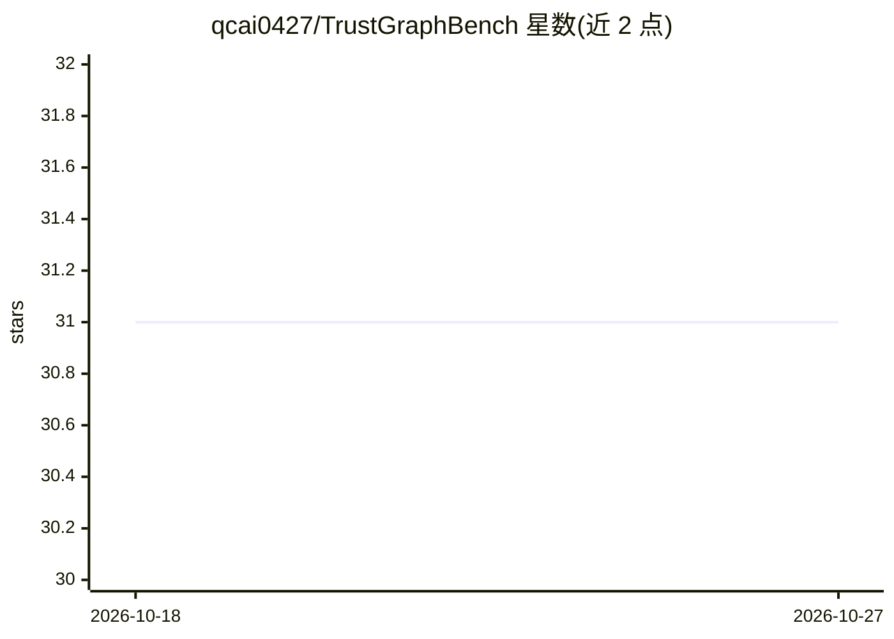

# qcai0427/TrustGraphBench

⭐ 31 · Python · 推送 2026-10-24 · [GitHub](https://github.com/qcai0427/TrustGraphBench) · 个人维护

**面向图与结构化 AI 的鲁棒性评测基准资源库**

以评测为中心的公开资源库，聚焦图感知与结构化 AI 设置下的鲁棒性评估：提供基准任务定义、基线评测脚本、压力测试协议、实验配置与报告工具（按开发阶段可能包含这些组件），用于测量模型在结构扰动、噪声与对抗条件下的稳定性，并在受控条件下对比基线与改进方法。面向可信 AI 与鲁棒性方向的研究者、图学习研究者以及需要可复现可靠性评测流程的实践者。README 未给出具体安装命令或已完成的评测结果，仓库自述为持续扩展中的评测工作区。

## 筛选速览

| 维度 | 判定 | 备注 |
|---|---|---|
| AI 角色 | `ai-ecosystem` | LLM/agent 周边工具 |
| 许可风险 | `none` | — |
| 部署形态 | `None` |  |
| 模型依赖 | — | README 未给出锁定关系 |
| 硬件要求 | — | 无带数字的原话,不猜 |
| 安装摩擦 | `low` | 无编译、无系统依赖或容器化 |
| 成熟度 | — | 结构信号不足 |

## 能力要点

- 面向结构扰动、噪声与对抗条件的压力测试式评测组织方式
- 受控条件下对比基线与增强方法的实验工作流
- 涵盖基准任务定义、评测脚本、实验配置与报告工具的组件规划

## 适用场景

- 研究者测试图学习模型在输入结构被扰动后的可靠性
- 在相同受控条件下对比不同方法的鲁棒性表现
- 搭建可复现的可信 AI 评测实验流程

## 场景标签

`模型评测` · 领域:评测与运维

## 证据(README 行号)

> L3: TrustGraphBench is a benchmark-oriented repository for robustness evaluation in graph-aware and structured AI settin
> L7: Rather than presenting a single model as the center of the repository, TrustGraphBench is organized as an evaluation
> L23: TrustGraphBench is intended to support evaluation tasks such as:

## 星数曲线

2026-10-18 31 → 2026-10-27 31（+0）

---
*卡片 v1 · prompt 1.4 · 生成 2026-10-26 · 置信度 mid · 依据 README sha `3be638421e7e` · [字段定义](../../DATASET.md)*
