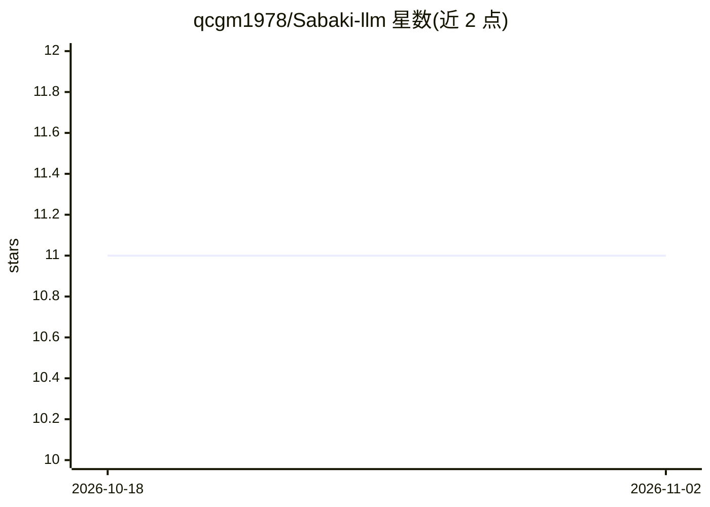

# qcgm1978/Sabaki-llm

⭐ 11 · JavaScript · MIT · 推送 2025-12-07 · [GitHub](https://github.com/qcgm1978/Sabaki-llm) · 个人维护 · 中文 README

**结合 LLM 与 KataGo 的围棋分析桌面助手**

基于 Sabaki（Electron）围棋界面开发的智能围棋助手：通过 MCP 协议连接 LLM 与 KataGo 围棋引擎，LLM 负责理解自然语言提问并生成解释，KataGo 提供落子建议与胜率分析；用户可用自然语言询问战略战术、请求特定区域棋盘分析。另集成 golaxy 围棋平台，支持在线对弈、观棋与对局数据同步。README 未给出安装与运行命令，基于 Sabaki MIT 许可证开发。

## 筛选速览

| 维度 | 判定 | 备注 |
|---|---|---|
| AI 角色 | `ai-native` | 本体是模型或模型工具 |
| 许可风险 | `permissive` | MIT |
| 部署形态 | `None` |  |
| 模型依赖 | — | README 未给出锁定关系 |
| 硬件要求 | — | 无带数字的原话,不猜 |
| 安装摩擦 | `low` | 无编译、无系统依赖或容器化 |
| 成熟度 | — | 结构信号不足 |

## 能力要点

- MCP 协议连接 LLM 与 KataGo 引擎的 Agent 架构
- 自然语言提问获得棋盘区域分析与着法解释
- 集成 golaxy 平台的在线对弈与观棋功能
- 对话历史持久化，可上下键切换历史问题

## 适用场景

- 用自然语言询问某手棋或某区域的优劣
- 获得带解释的落子建议与胜率分析
- 在 golaxy 平台对弈时同步分析对局

## 场景标签

`AI 助手` · 领域:对话与助手

## 证据(README 行号)

> L29: - 通过自然语言与围棋 AI 交互
> L37: - 结合 LLM 的自然语言理解和 KataGo 的专业围棋分析能力
> L53: 本项目是基于 Sabaki 围棋界面开发的智能围棋助手，专注于将先进的 AI 技术与围棋分析

## 星数曲线

2026-10-18 11 → 2026-11-02 11（+0）

---
*卡片 v1 · prompt 1.4 · 生成 2026-11-01 · 置信度 mid · 依据 README sha `102191555213` · [字段定义](../../DATASET.md)*
