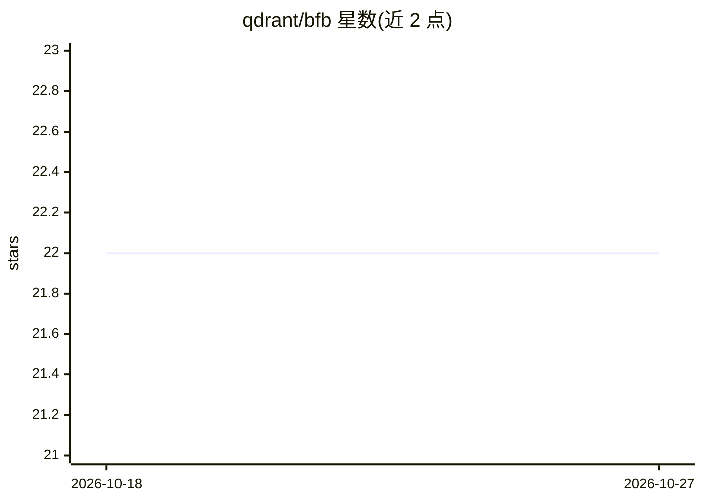

# qdrant/bfb

⭐ 22 · Rust · 推送 2026-10-19 · [GitHub](https://github.com/qdrant/bfb) · 组织维护

**面向 Qdrant 的高负载基准测试工具**

Qdrant 官方维护的向量数据库压测工具：通过 YAML 配置描述集合形状与搜索/滚动请求，用运行时参数控制规模、并发与限速，向指定 Qdrant 实例上传数据并测量性能。数据源支持 vector-db-benchmark 兼容格式（h5/tar/sparse/npy/parquet/ColBERT 风格 multivector），支持分片数据集按范围请求计量行数、边下边传以降低磁盘占用，并可对带 ground truth 的查询集计算召回率。提供 Linux/macOS 预编译静态二进制、Docker 镜像与 cargo 安装，支持自更新。

## 筛选速览

| 维度 | 判定 | 备注 |
|---|---|---|
| AI 角色 | `ai-ecosystem` | LLM/agent 周边工具 |
| 许可风险 | `none` | — |
| 部署形态 | `self-host` | docker 或自建部署 |
| 模型依赖 | — | README 未给出锁定关系 |
| 硬件要求 | — | 无带数字的原话,不猜 |
| 安装摩擦 | `low` | 无编译、无系统依赖或容器化 |
| 成熟度 | — | 结构信号不足 |

## 能力要点

- YAML 描述集合/搜索形状，运行时参数控制规模与并发
- 支持 h5/tar/sparse/npy/parquet/ColBERT 风格 multivector 数据源
- 分片数据集按范围请求计量行数，cache: evict 边下边传降低峰值磁盘
- 对照 ground truth 计算召回率，支持带条件的过滤查询集

## 适用场景

- 对 Qdrant 集群做上传、搜索、滚动工作负载压测
- 上传 LAION 等大型分片数据集测召回率与吞吐
- 在有限磁盘空间下流式加载超大数据集做基准测试

## 场景标签

 · 领域:向量数据库/性能测试

## 证据(README 行号)

> L3: Benchmarking tool for the Qdrant project
> L262: ground-truth nearest neighbors. Recall (`|found ∩ expected[:k]| / k`, the same

## 星数曲线

2026-10-18 22 → 2026-10-27 22（+0）

---
*卡片 v1 · prompt 1.4 · 生成 2026-10-27 · 置信度 high · 依据 README sha `423c3b456e3a` · [字段定义](../../DATASET.md)*
