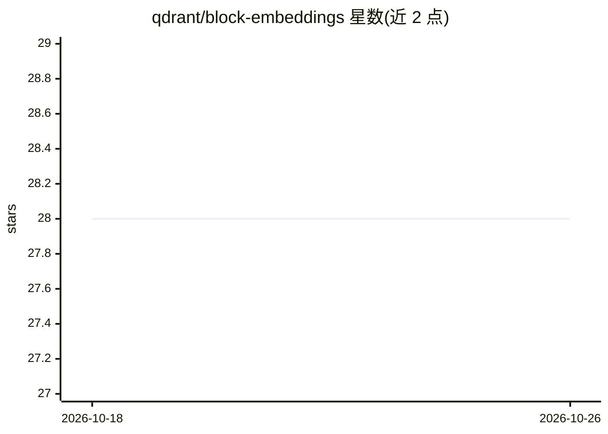

# qdrant/block-embeddings

⭐ 28 · Python · 推送 2026-06-23 · [GitHub](https://github.com/qdrant/block-embeddings) · 组织维护

**稠密向量到块向量的可训练变换：置信度估计与稀疏化**

Qdrant 维护的概念验证项目：将稠密嵌入切分为多个块，对每块分别施加 SoftMax，训练一个变换模型，用于放大数据集特定特征。通过 Qdrant API 采集集合的相似度矩阵作为训练目标，采用 triplet loss 使变换后嵌入保持原有相似度关系。产出可用于：嵌入置信度/离群检测、稠密转稀疏嵌入（候选预取）、特征可解释性分析与检索方向调控。以 Python 源码形式提供，使用 uv 管理依赖，需自行训练模型。

## 筛选速览

| 维度 | 判定 | 备注 |
|---|---|---|
| AI 角色 | `ai-ecosystem` | LLM/agent 周边工具 |
| 许可风险 | `none` | — |
| 部署形态 | `library` | 以包/库形式分发 |
| 模型依赖 | — | README 未给出锁定关系 |
| 硬件要求 | — | 无带数字的原话,不猜 |
| 安装摩擦 | `low` | 无编译、无系统依赖或容器化 |
| 成熟度 | `idea` | |

## 能力要点

- 分块 SoftMax 变换，每块放大一个特征
- 通过 Qdrant API 采集相似度矩阵，triplet loss 训练
- 支持稠密嵌入转稀疏嵌入用于候选预取
- 自声明为 proof of concept

## 适用场景

- 检测不属于目标集合的离群查询/图片
- 将稠密嵌入转为稀疏嵌入做快速候选预取
- 研究嵌入中特征与对象的对应关系以解释检索结果

## 场景标签

`语义搜索` · 领域:知识与检索

## 证据(README 行号)

> L3: This project is a proof of concept of a technique of dense embeddings transformation, which is aimed to amplify data
> L60: 1. **Data Collection**: We use Qdrant API to obtain a similarity matrix for a subset of the collection. This matrix
> L62: 2. **Model Architecture**: The model takes dense embeddings as input and transforms them into block embeddings, whe

## 星数曲线

2026-10-18 28 → 2026-10-26 28（+0）

---
*卡片 v1 · prompt 1.4 · 生成 2026-10-26 · 置信度 mid · 依据 README sha `07f98d81fa01` · [字段定义](../../DATASET.md)*
