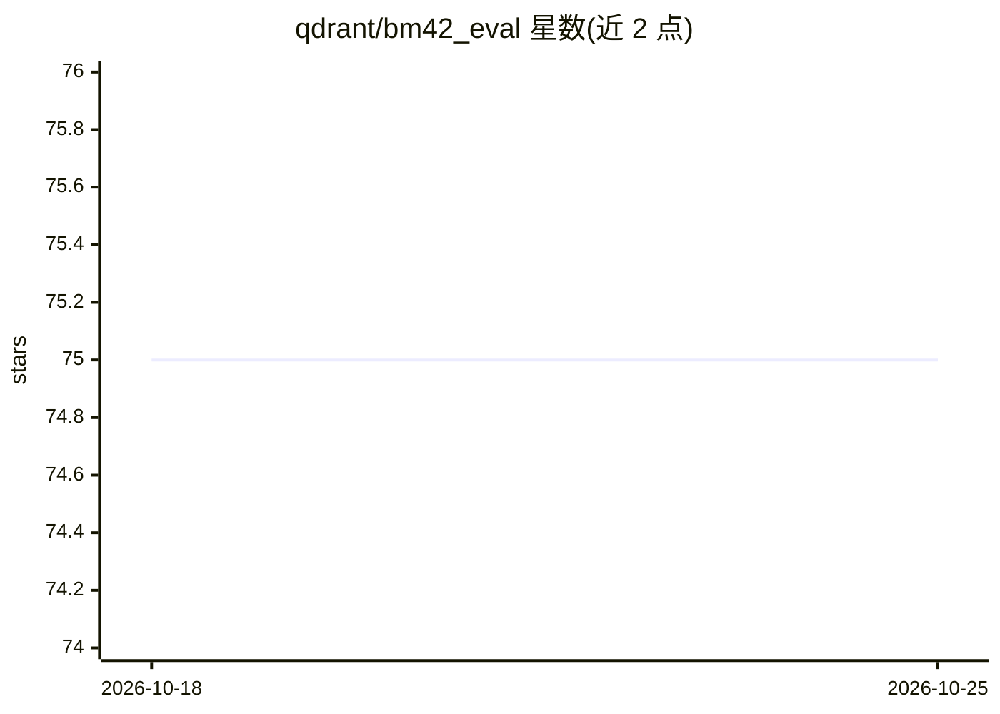

# qdrant/bm42_eval

⭐ 75 · Python · 推送 2026-06-23 · [GitHub](https://github.com/qdrant/bm42_eval) · 组织维护

**BM42 稀疏索引与 BM25 的检索评测基准代码**

Qdrant 维护的评测仓库：在 BEIR 的 Quora 数据集上，用同一评测脚本对比三种方案——基于 tantivy 的 BM25、BM42 稀疏向量（all-minilm-l6-v2 骨干、fastembed 推理、Qdrant 索引与搜索、Qdrant 内计算 IDF），以及与 BM42 同分词器/词干化器的纯稀疏向量 BM25。README 记录三组命中率与召回率数值。依赖通过 pip requirements.txt 安装，Qdrant 通过 docker 运行。

## 筛选速览

| 维度 | 判定 | 备注 |
|---|---|---|
| AI 角色 | `ai-ecosystem` | LLM/agent 周边工具 |
| 许可风险 | `none` | — |
| 部署形态 | `self-host` | docker 或自建部署 |
| 模型依赖 | — | README 未给出锁定关系 |
| 硬件要求 | — | 无带数字的原话,不猜 |
| 安装摩擦 | `low` | 无编译、无系统依赖或容器化 |
| 成熟度 | — | 结构信号不足 |

## 能力要点

- 三种方案在 Quora 数据集上的对比评测脚本
- BM42 使用 fastembed 推理 + Qdrant 稀疏索引
- 提供与 BM42 相同分词器/词干化器的纯稀疏向量 BM25 对照组
- README 记录各方案的 hits/precision/recall 数值

## 适用场景

- 复现 BM42 与 BM25 的检索效果对比
- 在 BEIR Quora 数据集上运行稀疏索引评测
- 了解稀疏向量方案与传统 BM25 的对照设置方式

## 场景标签

`模型评测` · 领域:评测与运维

## 证据(README 行号)

> L1: # BM42 vs BM25 benchmark
> L66: ## BM42 - with `all-minilm-l6-v2` as a backbone
> L68: BM42 uses `fastembed` implementation for inference, and `qdrant` for indexing and search.

## 星数曲线

2026-10-18 75 → 2026-10-25 75（+0）

---
*卡片 v1 · prompt 1.4 · 生成 2026-10-24 · 置信度 high · 依据 README sha `b2d230b9455c` · [字段定义](../../DATASET.md)*
