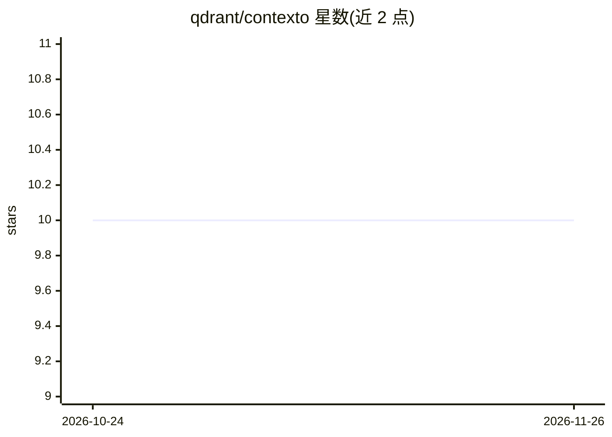

# qdrant/contexto

⭐ 10 · JavaScript · 推送 2026-09-04 · [GitHub](https://github.com/qdrant/contexto) · 个人维护

**用词向量求解 contexto.me 游戏的脚本**

一个使用词嵌入与向量搜索求解 contexto.me 词汇游戏的脚本。工作流程：克隆仓库后用 poetry 安装依赖，运行 prepare_embeddings 生成嵌入与词表，再运行 guess 命令开始猜词；首词由用户给出，后续词由算法生成。README 给出的平均猜测次数为 30 次。

## 筛选速览

| 维度 | 判定 | 备注 |
|---|---|---|
| AI 角色 | `ai-native` | 本体是模型或模型工具 |
| 许可风险 | `none` | — |
| 部署形态 | `library` | 以包/库形式分发 |
| 模型依赖 | — | README 未给出锁定关系 |
| 硬件要求 | — | 无带数字的原话,不猜 |
| 安装摩擦 | `low` | 无编译、无系统依赖或容器化 |
| 成熟度 | — | 结构信号不足 |

## 能力要点

- 基于词嵌入与向量搜索生成候选词
- prepare_embeddings 模块生成嵌入与词表
- guess 命令自动给出后续猜测词
- README 记录平均猜测次数为 30

## 适用场景

- 辅助游玩 contexto.me 词汇游戏
- 学习词向量相似度在猜词中的用法

## 场景标签

`语义搜索` · 领域:知识与检索

## 证据(README 行号)

> L5: This repository contains a solution to the game using vector search.
> L22: python -m contexto.prepare_embeddings

## 星数曲线

2026-10-24 10 → 2026-11-26 10（+0）

---
*卡片 v1 · prompt 1.4 · 生成 2026-11-19 · 置信度 mid · 依据 README sha `041a6ddde3d2` · [字段定义](../../DATASET.md)*
