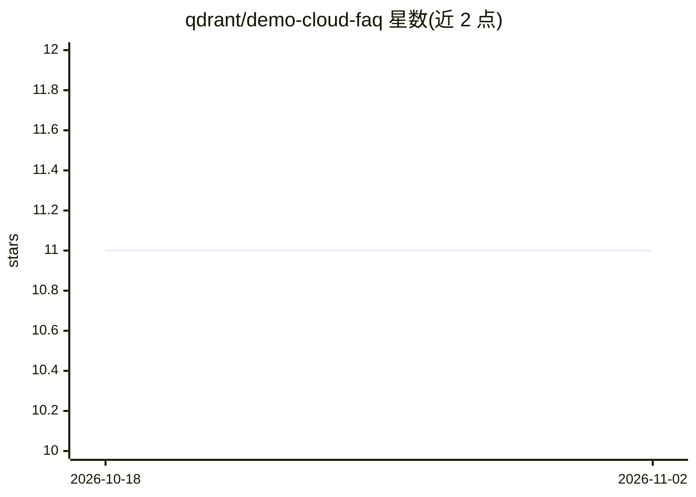

# qdrant/demo-cloud-faq

⭐ 11 · Python · 推送 2026-06-20 · [GitHub](https://github.com/qdrant/demo-cloud-faq) · 组织维护

**用 Quaterion 训练云厂商 FAQ 问答模型的教程（≤30字）**

Qdrant 出品的相似度学习教程工程：基于 Quaterion 框架训练一个模型，用于回答主流云厂商文档 FAQ 页面中的问题，属 NLP 问答任务。依赖通过 poetry 管理，README 提供 install_dependencies.sh 一键安装脚本与 download_data.sh 数据下载脚本，数据集来自 Qdrant 的 Google Storage（cloud_faq_dataset.jsonl）并自动做训练/验证切分。完整教程在外部链接中。仓库为教程演示性质，非可直接部署的产品。

## 筛选速览

| 维度 | 判定 | 备注 |
|---|---|---|
| AI 角色 | `ai-native` | 本体是模型或模型工具 |
| 许可风险 | `none` | — |
| 部署形态 | `None` |  |
| 模型依赖 | — | README 未给出锁定关系 |
| 硬件要求 | — | 无带数字的原话,不猜 |
| 安装摩擦 | `low` | 无编译、无系统依赖或容器化 |
| 成熟度 | — | 结构信号不足 |

## 能力要点

- 基于 Quaterion 的相似度学习问答教程
- 自有云厂商 FAQ 数据集，自动 train-val 切分
- poetry 管理依赖，提供一键安装与下载脚本

## 适用场景

- 学习如何用相似度学习方法解决 FAQ 问答任务
- 作为 Quaterion 框架的入门示例工程运行

## 场景标签

`教程课程` · 领域:学习与行业

## 证据(README 行号)

> L11: This tutorial covers one of NLP problems - Q&A.
> L12: Here we train a model capable of answering to questions from F.A.Q. pages of popular cloud providers.

## 星数曲线

2026-10-18 11 → 2026-11-02 11（+0）

---
*卡片 v1 · prompt 1.4 · 生成 2026-11-01 · 置信度 high · 依据 README sha `052f13e06ee7` · [字段定义](../../DATASET.md)*
