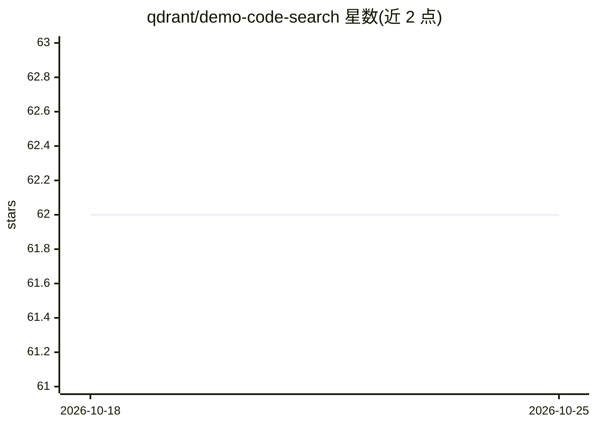

# qdrant/demo-code-search

⭐ 63 · Python · 推送 2026-10-23 · [GitHub](https://github.com/qdrant/demo-code-search) · 组织维护

**Qdrant 官方代码语义搜索演示：混合检索 Qdrant 源码**

基于 Qdrant 向量数据库的代码搜索演示应用，索引 qdrant/qdrant 仓库的 142,164 个点（函数签名、代码片段、整文件三个集合），以稠密向量（mxbai-embed-large-v1）加 BM25 稀疏检索经 RRF 融合的混合方案返回排序结果。嵌入由 Qdrant Cloud Inference 在集群内完成，后端为三个无运行时依赖的 Vercel TypeScript 函数。限制：无法本地完整运行，需 Qdrant Cloud 集群；README 附带可复现的基准测试脚本 bench/，报告十种检索配置在 docstring/paraphrase 两类查询上的表现。

## 筛选速览

| 维度 | 判定 | 备注 |
|---|---|---|
| AI 角色 | `ai-ecosystem` | LLM/agent 周边工具 |
| 许可风险 | `none` | — |
| 部署形态 | `self-host` | docker 或自建部署 |
| 模型依赖 | — | README 未给出锁定关系 |
| 硬件要求 | — | 无带数字的原话,不猜 |
| 安装摩擦 | `low` | 无编译、无系统依赖或容器化 |
| 成熟度 | — | 结构信号不足 |

## 能力要点

- 稠密 + BM25 稀疏混合检索，RRF 融合，单次往返返回结果
- 索引 qdrant/qdrant 源码三集合共 142,164 点（签名/片段/文件）
- 基准脚本 bench/ 可复现十种检索配置与编码器对比测量
- 发现并量化了 Qdrant Cloud Inference 对 all-MiniLM-L6-v2 的 512 token 截断问题

## 适用场景

- 在线搜索 Qdrant Rust 源码中的函数与结构
- 了解混合检索（稠密+BM25+RRF）在代码搜索上的实测效果
- 参考其 LSP/rust-analyzer 驱动的代码分块与 textify 索引方案

## 场景标签

`语义搜索` · 领域:知识与检索

## 证据(README 行号)

> L4: This repository is that tool, built on Qdrant, searching
> L32: Railway existed only for that middle step. Qdrant Cloud Inference does the
> L56: **You can no longer run the whole demo locally.** Qdrant Cloud Inference is a Qdrant

## 星数曲线

2026-10-18 62 → 2026-10-25 62（+0）

---
*卡片 v1 · prompt 1.4 · 生成 2026-10-24 · 置信度 mid · 依据 README sha `043282f6d8ee` · [字段定义](../../DATASET.md)*
