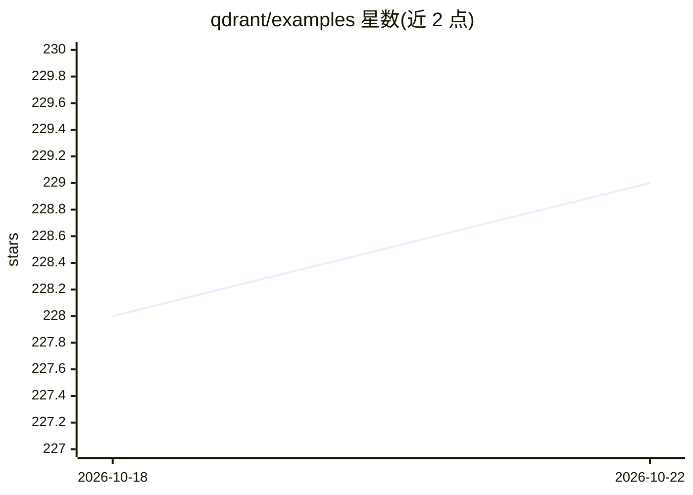

# qdrant/examples

⭐ 230 · Jupyter Notebook · Apache-2.0 · 推送 2026-10-22 · [GitHub](https://github.com/qdrant/examples) · 组织维护

**Qdrant 向量搜索引擎的示例与教程合集**

由 Qdrant 维护的官方教程仓库，收录 30 余个示例，覆盖语义搜索、多模态检索、GraphRAG、混合搜索、二值量化、多向量检索、协同过滤与 RAG 评测等主题。每个条目以表格形式列出说明与所用技术（如 CLIP、LangChain、LlamaIndex、ColPali、DSPy、Ragas），另含 Qdrant Essentials 与多向量搜索等多模块课程笔记本。面向使用 Qdrant 及配套技术栈的开发者与学习者。

## 筛选速览

| 维度 | 判定 | 备注 |
|---|---|---|
| AI 角色 | `ai-knowledge` | 知识聚合/清单类 |
| 许可风险 | `permissive` | Apache-2.0 |
| 部署形态 | `None` |  |
| 模型依赖 | — | README 未给出锁定关系 |
| 硬件要求 | — | 无带数字的原话,不猜 |
| 安装摩擦 | `low` | 无编译、无系统依赖或容器化 |
| 成熟度 | — | 结构信号不足 |

## 能力要点

- 30 余个示例覆盖语义搜索、RAG、混合搜索与量化等主题
- 含多天课程笔记本（HNSW 调优、大规模摄取、多向量检索）
- 每条示例标注所用技术栈（CLIP/ColPali/DSPy/Ragas 等）
- 包含 RAG 流水线端到端评测示例（recall@10、Ragas 指标）

## 适用场景

- 跟随示例上手 Qdrant 语义搜索与推荐 API
- 学习多向量检索、二值量化等进阶用法
- 参考 GraphRAG、混合搜索等完整流水线搭建方案

## 场景标签

`向量数据库` `教程课程` `语义搜索` `RAG` · 领域:知识与检索

## 证据(README 行号)

> L1: # Qdrant Examples
> L3: This repo contains a collection of tutorials, demos, and how-to guides on how to use Qdrant and adjacent technologie

## 星数曲线

2026-10-18 228 → 2026-10-22 229（+1）

---
*卡片 v1 · prompt 1.4 · 生成 2026-10-22 · 置信度 high · 依据 README sha `6d3a061afd91` · [字段定义](../../DATASET.md)*
