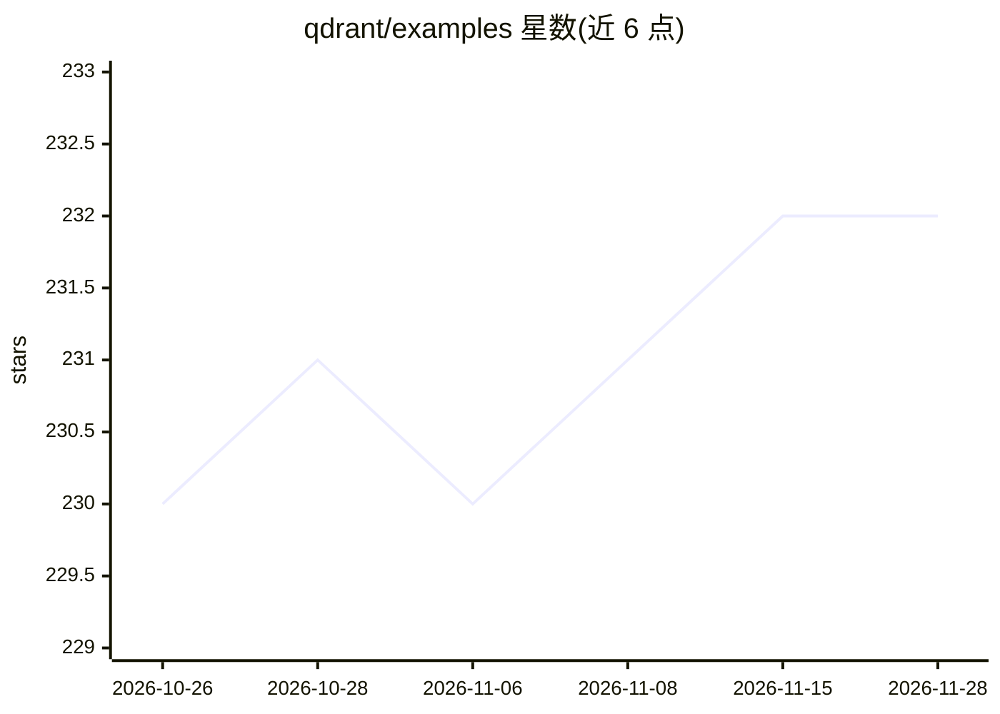

# qdrant/examples

⭐ 232 · Jupyter Notebook · Apache-2.0 · 推送 2026-11-25 · [GitHub](https://github.com/qdrant/examples) · 组织维护

**Qdrant 向量检索引擎的教程与示例集**

收录面向 Qdrant 向量搜索引擎的教程、演示与操作指南，以表格形式编目为数十个示例条目，覆盖语义搜索、RAG、图像/音频/多模态检索、二值量化、混合检索、协同过滤、代码搜索等主题；每个条目标注所用技术栈（如 LangChain、LlamaIndex、FastEmbed、ColPali）并可跳转对应实现。供希望学习如何使用 Qdrant 及相关技术的开发者查阅，按教程逐个运行，不构成完整产品。

## 筛选速览

| 维度 | 判定 | 备注 |
|---|---|---|
| AI 角色 | `ai-knowledge` | 知识聚合/清单类 |
| 许可风险 | `permissive` | Apache-2.0 |
| 部署形态 | `None` |  |
| 模型依赖 | — | README 未给出锁定关系 |
| 硬件要求 | — | 无带数字的原话,不猜 |
| 安装摩擦 | `low` | 无编译、无系统依赖或容器化 |
| 成熟度 | — | 结构信号不足 |

## 能力要点

- 以表格编目数十个教程/演示/指南条目，含技术栈索引
- 覆盖文本、图像、音频、多模态语义搜索与推荐场景
- 包含 RAG、量化、混合检索、协同过滤等进阶主题
- 提供多天课程式 notebook（Qdrant Essentials / Multi-Vector Search）

## 适用场景

- 我想按教程上手 Qdrant 的语义搜索与推荐 API
- 我需要参考 RAG、量化或混合检索的可运行示例
- 我想为电商或文档场景搭建以图搜图、PDF 检索

## 场景标签

`RAG` `语义搜索` `教程课程` · 领域:知识与检索

## 证据(README 行号)

> L3: This repo contains a collection of tutorials, demos, and how-to guides on how to use Qdrant and adjacent technologie
> L5: |Example|Description|Technologies|

## 星数曲线

2026-10-26 230 → 2026-11-28 232（+2）

---
*卡片 v1 · prompt 1.4 · 生成 2026-11-25 · 置信度 high · 依据 README sha `95a71b7fc2db` · [字段定义](../../DATASET.md)*
