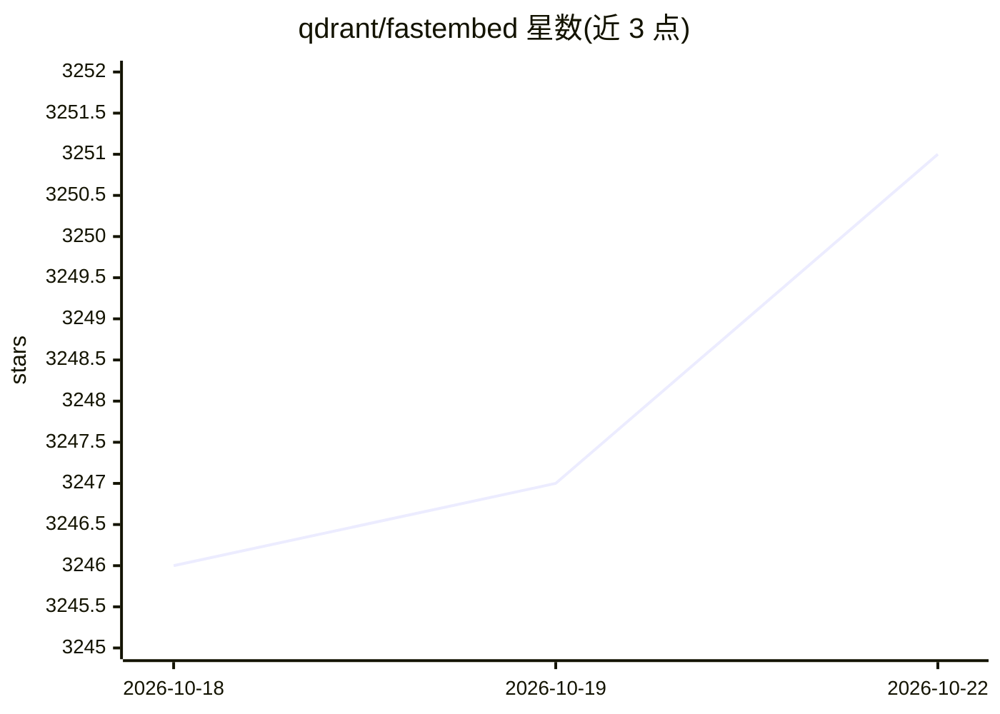

# qdrant/fastembed

⭐ 3,255 · Python · Apache-2.0 · 推送 2026-10-22 · [GitHub](https://github.com/qdrant/fastembed) · [官网](https://qdrant.github.io/fastembed/) · 组织维护

**轻量级 Python 嵌入生成库，基于 ONNX Runtime 无需 GPU**

Qdrant 维护的 Python 嵌入向量生成库：通过 ONNX Runtime 运行各类嵌入模型，不依赖 PyTorch 与 GPU，支持 CPU 与可选 GPU（fastembed-gpu 包，CUDA 12.x）。覆盖稠密文本嵌入、稀疏嵌入（SPLADE++）、迟交互模型（ColBERT/ColPali）、图像嵌入与交叉编码器重排序，可加载列表外的自定义模型。面向构建检索/RAG/向量搜索的开发者，可与 Qdrant Client 搭配使用。

## 筛选速览

| 维度 | 判定 | 备注 |
|---|---|---|
| AI 角色 | `ai-native` | 本体是模型或模型工具 |
| 许可风险 | `permissive` | Apache-2.0 |
| 部署形态 | `library` | 以包/库形式分发 |
| 模型依赖 | — | README 未给出锁定关系 |
| 硬件要求 | — | 无带数字的原话,不猜 |
| 安装摩擦 | `medium` | 含编译或系统依赖之一 |
| 成熟度 | — | 结构信号不足 |

## 能力要点

- 稠密/稀疏/迟交互文本嵌入与图像嵌入、多模态（ColPali）
- 基于 ONNX Runtime，无需 PyTorch 依赖与 GPU 即可运行
- 支持自定义列表外模型加载与文本交叉编码器重排序
- 可选 GPU 支持（fastembed-gpu，CUDA 12.x）

## 适用场景

- 为 RAG 与向量搜索流水线生成查询和文档嵌入
- 在 Serverless 等无 GPU 环境运行嵌入模型
- 配合 Qdrant 做检索，或用重排序器精排结果

## 场景标签

`语义搜索` · 领域:知识与检索

## 证据(README 行号)

> L3: FastEmbed is a lightweight, fast, Python library built for embedding generation. We support popular text models. Ple
> L9: 1. Light: FastEmbed is a lightweight library with few external dependencies. We don't require a GPU and don't downlo

## 星数曲线

2026-10-18 3,246 → 2026-10-22 3,251（+5）

---
*卡片 v1 · prompt 1.4 · 生成 2026-10-20 · 置信度 high · 依据 README sha `7a3151e8c00c` · [字段定义](../../DATASET.md)*
