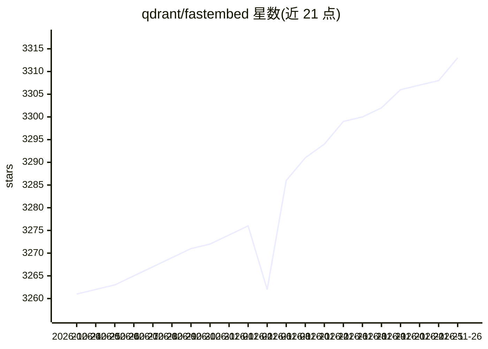

# qdrant/fastembed

⭐ 3,313 · Python · Apache-2.0 · 推送 2026-11-25 · [GitHub](https://github.com/qdrant/fastembed) · [官网](https://qdrant.github.io/fastembed/) · 组织维护

**轻量 Python 嵌入生成库：文本/图像/多模态向量与重排**

基于 ONNX Runtime 的 Python 嵌入生成库，无需 GPU 与 PyTorch 依赖，可在 AWS Lambda 等 serverless 环境运行。支持稠密文本嵌入、稀疏嵌入（SPLADE++）、Late Interaction 模型（ColBERT）、图像嵌入、多模态 ColPali 以及交叉编码重排器，并支持接入列表外自定义模型与 GPU 运行（需另装 fastembed-gpu 包）。默认模型为 MTEB 排行榜中的 Flag Embedding，支持 query/passage 前缀。与 Qdrant 客户端提供集成安装方式。

## 筛选速览

| 维度 | 判定 | 备注 |
|---|---|---|
| AI 角色 | `ai-native` | 本体是模型或模型工具 |
| 许可风险 | `permissive` | Apache-2.0 |
| 部署形态 | `library` | 以包/库形式分发 |
| 模型依赖 | — | README 未给出锁定关系 |
| 硬件要求 | — | 无带数字的原话,不猜 |
| 安装摩擦 | `medium` | 含编译或系统依赖之一 |
| 成熟度 | — | 结构信号不足 |

## 能力要点

- 基于 ONNX Runtime，无需 GPU 与 PyTorch 大体积依赖
- 支持稠密、稀疏（SPLADE++）、Late Interaction（ColBERT）、图像与多模态（ColPali）嵌入
- 提供交叉编码重排器（TextCrossEncoder）
- 支持加载受支持列表之外的自定义模型（ModelSource/PoolingType）

## 适用场景

- 为检索增强生成（RAG）流程批量生成文档与查询向量
- 为向量数据库（如 Qdrant）构建检索索引
- 在无 GPU 的 serverless 环境中生成嵌入
- 对检索结果做交叉编码重排

## 场景标签

`语义搜索` · 领域:知识与检索

## 证据(README 行号)

> L3: FastEmbed is a lightweight, fast, Python library built for embedding generation. We support popular text models. Ple
> L9: 1. Light: FastEmbed is a lightweight library with few external dependencies. We don't require a GPU and don't downlo
> L35: Fastembed supports a variety of models for different tasks and modalities.

## 星数曲线

2026-10-24 3,261 → 2026-11-26 3,313（+52）

---
*卡片 v1 · prompt 1.4 · 生成 2026-11-26 · 置信度 high · 依据 README sha `033ef5854bf9` · [字段定义](../../DATASET.md)*
