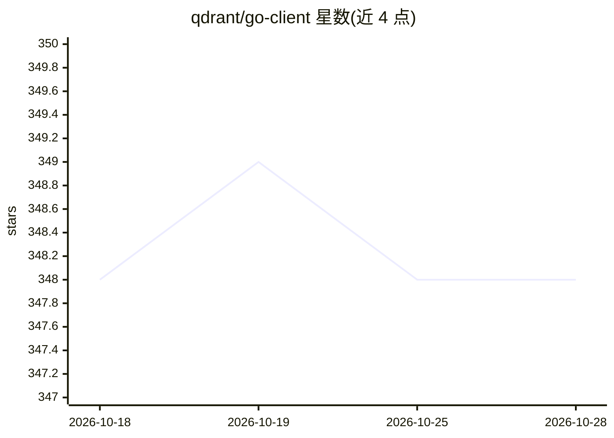

# qdrant/go-client

⭐ 348 · Go · Apache-2.0 · 推送 2026-10-28 · [GitHub](https://github.com/qdrant/go-client) · 组织维护

**Qdrant 向量搜索引擎的官方 Go 客户端库**

由 Qdrant 团队维护的 Go 语言客户端库，封装 gRPC 通道连接 Qdrant 向量搜索引擎，高层 API 覆盖创建集合、向量 upsert、相似度查询与带过滤条件的查询；通过 Config 支持 API key 认证与 TLS 等 gRPC 选项。供在 Go 项目中接入 Qdrant 的开发者使用，安装方式为 go get，Apache 2.0 许可。

## 筛选速览

| 维度 | 判定 | 备注 |
|---|---|---|
| AI 角色 | `ai-ecosystem` | LLM/agent 周边工具 |
| 许可风险 | `permissive` | Apache-2.0 |
| 部署形态 | `None` |  |
| 模型依赖 | — | README 未给出锁定关系 |
| 硬件要求 | — | 无带数字的原话,不猜 |
| 安装摩擦 | `low` | 无编译、无系统依赖或容器化 |
| 成熟度 | — | 结构信号不足 |

## 能力要点

- 高层客户端封装低层 gRPC 通道
- 支持集合创建、向量 upsert、相似度查询
- 通过 qdrant.Config 支持 API key 认证与 TLS

## 适用场景

- 在 Go 服务中向 Qdrant 写入与检索向量
- 构建带过滤条件的向量相似度搜索
- 通过 API key + TLS 连接托管 Qdrant 实例

## 场景标签

`向量数据库` · 领域:知识与检索

## 证据(README 行号)

> L5:  Go client for the Qdrant vector search engine.
> L43: Internally, the high-level client uses a low-level gRPC client to interact with

## 星数曲线

2026-10-18 348 → 2026-10-28 348（+0）

---
*卡片 v1 · prompt 1.4 · 生成 2026-10-21 · 置信度 high · 依据 README sha `af20b391b0c1` · [字段定义](../../DATASET.md)*
