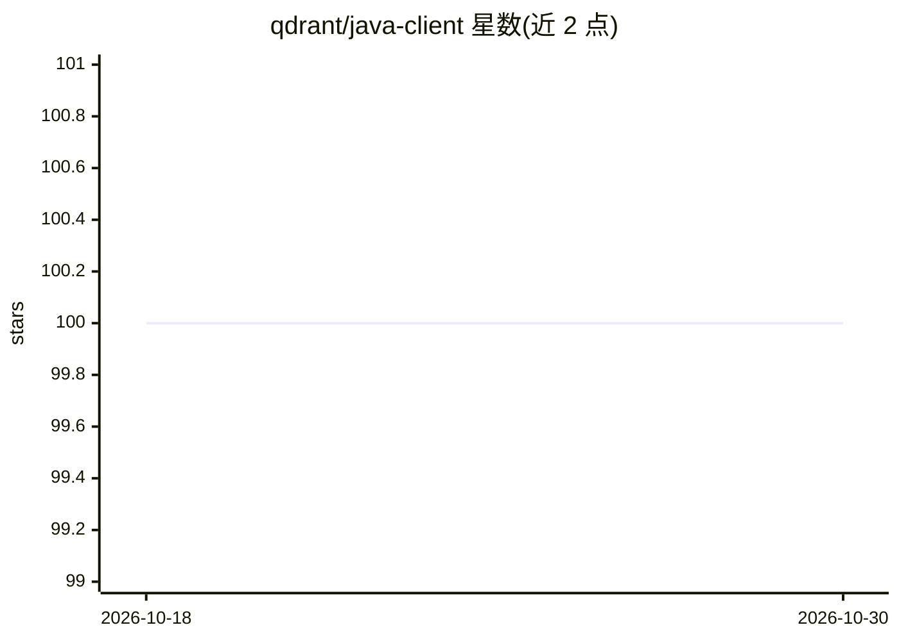

# qdrant/java-client

⭐ 100 · Java · Apache-2.0 · 推送 2026-10-23 · [GitHub](https://github.com/qdrant/java-client) · [官网](https://qdrant.github.io/java-client) · 组织维护

**Qdrant 向量数据库的官方 Java 客户端库**

Qdrant 官方维护的 Java 客户端库，通过高层 QdrantClient 封装低层 gRPC 客户端连接 Qdrant 向量搜索引擎，提供集合创建、向量插入、相似度搜索与条件过滤等实用方法，方法均返回 ListenableFuture；支持 TLS 与 API key 认证配置，实现 AutoCloseable。要求 Java 8 及以上，通过 Maven/SBT/Gradle 依赖引入，面向在 Java 应用中接入 Qdrant 的开发者。

## 筛选速览

| 维度 | 判定 | 备注 |
|---|---|---|
| AI 角色 | `ai-ecosystem` | LLM/agent 周边工具 |
| 许可风险 | `permissive` | Apache-2.0 |
| 部署形态 | `None` |  |
| 模型依赖 | — | README 未给出锁定关系 |
| 硬件要求 | — | 无带数字的原话,不猜 |
| 安装摩擦 | `medium` | 含编译或系统依赖之一 |
| 成熟度 | — | 结构信号不足 |

## 能力要点

- 高层客户端封装低层 gRPC 通道与 Qdrant 交互
- 集合创建、向量插入、相似度搜索、条件过滤等方法
- 支持 TLS 证书校验与 API key 认证
- 方法返回 ListenableFuture，客户端实现 AutoCloseable

## 适用场景

- 在 Java 应用中连接并操作 Qdrant 向量数据库
- 构建带过滤条件的向量相似度检索
- 以异步方式执行向量入库与查询

## 场景标签

`向量数据库` · 领域:知识与检索

## 证据(README 行号)

> L6:  Java library for the Qdrant vector search engine.
> L16: Java client library with handy utility methods and overloads for interfacing with Qdrant.

## 星数曲线

2026-10-18 100 → 2026-10-30 100（+0）

---
*卡片 v1 · prompt 1.4 · 生成 2026-10-23 · 置信度 high · 依据 README sha `c33b47ed0451` · [字段定义](../../DATASET.md)*
