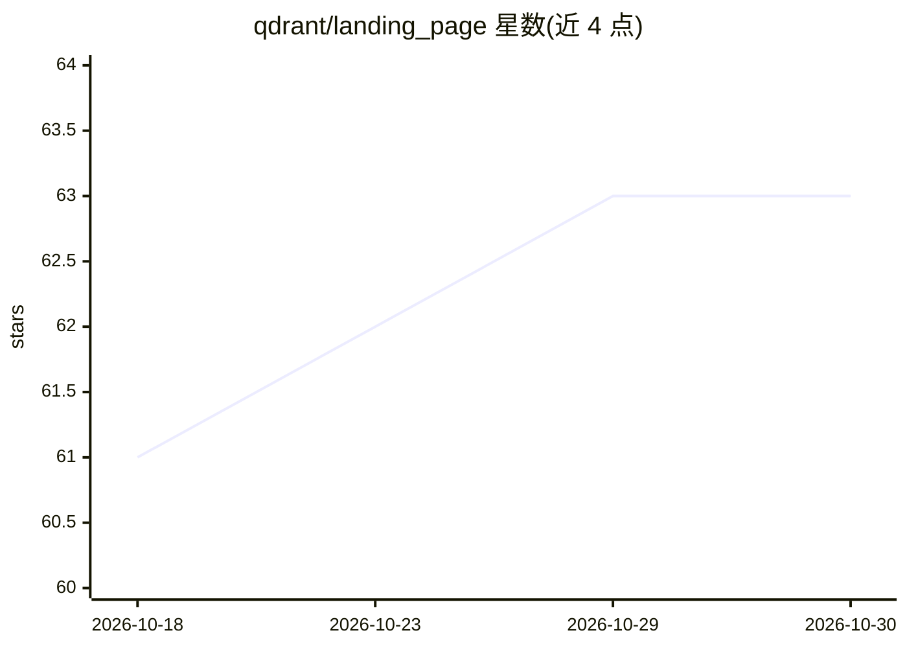

# qdrant/landing_page

⭐ 63 · SCSS · 推送 2026-10-29 · [GitHub](https://github.com/qdrant/landing_page) · 组织维护

**qdrant.tech 官网的 Hugo 源码仓库与内容维护指南**

Qdrant 公司官网（qdrant.tech）落地页的源码仓库，基于 Hugo 静态站点框架构建，开发环境另需 Node.js、npm 与 Dart Sass。README 面向网站内容贡献者，说明如何本地运行站点、撰写文章与文档页、维护客户 Logo 轮播、生成文章与文档的预览图（需 ImageMagick 与 cwebp）、归档旧文章并保留原链接，以及 Learn 门户的指南添加流程。合并到 master 分支后自动部署上线。

## 筛选速览

| 维度 | 判定 | 备注 |
|---|---|---|
| AI 角色 | `ai-enhanced` | 去掉 AI 部分产品仍成立 |
| 许可风险 | `none` | — |
| 部署形态 | `library` | 以包/库形式分发 |
| 模型依赖 | — | README 未给出锁定关系 |
| 硬件要求 | — | 无带数字的原话,不猜 |
| 安装摩擦 | `low` | 无编译、无系统依赖或容器化 |
| 成熟度 | — | 结构信号不足 |

## 能力要点

- 基于 Hugo 构建，提供 run.sh 一键本地运行
- 文章/文档均以 Markdown 管理并自动部署
- 提供文章归档机制（retired/hideFromList/sitemapExclude）且不破坏原链接
- 脚本自动生成文章与文档页的预览图（webp/jpg/社交图）

## 适用场景

- 为 Qdrant 官网撰写和提交博客文章或文档页
- 本地预览和调试官网改版效果
- 为文章批量生成各尺寸预览图

## 场景标签

 · 领域:网站/内容管理

## 证据(README 行号)

> L1: # Index
> L6: ## Prerequisites
> L10: - Hugo

## 星数曲线

2026-10-18 61 → 2026-10-30 63（+2）

---
*卡片 v1 · prompt 1.4 · 生成 2026-10-24 · 置信度 mid · 依据 README sha `234931fb7196` · [字段定义](../../DATASET.md)*
