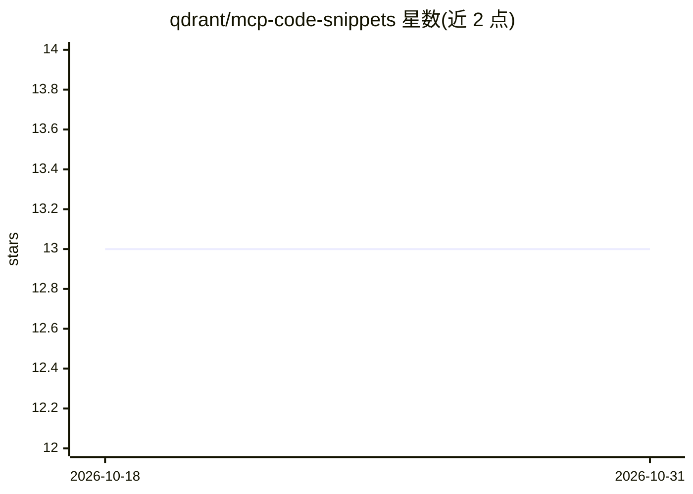

# qdrant/mcp-code-snippets

⭐ 13 · Python · 推送 2026-09-04 · [GitHub](https://github.com/qdrant/mcp-code-snippets) · 组织维护

**本地 MCP 适配器：让 Agent 在项目中查询代码片段**

Qdrant 维护的本地 MCP server 适配器，使 Agent（如 MCP 客户端）能够在项目中查找代码片段。本地实现可自动填充远程 MCP server 调用所需的部分参数（如项目语言、依赖信息），提高查找准确率；无结果时回退为无参数查询。默认连接 Qdrant 维护的远程代码片段 MCP server，也可通过自定义 MCP proxy 配置指向自有集合。以 pip/uv 安装的 Python 可执行程序提供，支持 stdio/sse/streamable-http 传输方式。

## 筛选速览

| 维度 | 判定 | 备注 |
|---|---|---|
| AI 角色 | `ai-ecosystem` | LLM/agent 周边工具 |
| 许可风险 | `none` | — |
| 部署形态 | `library` | 以包/库形式分发 |
| 模型依赖 | — | README 未给出锁定关系 |
| 硬件要求 | — | 无带数字的原话,不猜 |
| 安装摩擦 | `low` | 无编译、无系统依赖或容器化 |
| 成熟度 | `idea` | |

## 能力要点

- 本地自动填充参数（项目语言、依赖）以提升远程查询准确率
- 默认使用 Qdrant 维护的远程代码片段 MCP server，支持自定义集合
- 支持 stdio/sse/streamable-http 三种传输方式
- 可配置于 Cursor 等支持 MCP 协议的编辑器

## 适用场景

- 为 Cursor 等 MCP 客户端提供项目内代码片段查询能力
- 通过自定义 MCP proxy 配置接入自己的代码片段集合
- 让 Agent 在编码时查找可复用代码片段

## 场景标签

`语义搜索` · 领域:知识与检索

## 证据(README 行号)

> L3: This is an local adapter for MCP server that allows Agents to lookup code snippets in your project.
> L5: By default, it uses Qdrant-maintaned remote MCP server with a collection of code snippets, but you can use your own 

## 星数曲线

2026-10-18 13 → 2026-10-31 13（+0）

---
*卡片 v1 · prompt 1.4 · 生成 2026-10-31 · 置信度 high · 依据 README sha `3a689f11c87a` · [字段定义](../../DATASET.md)*
