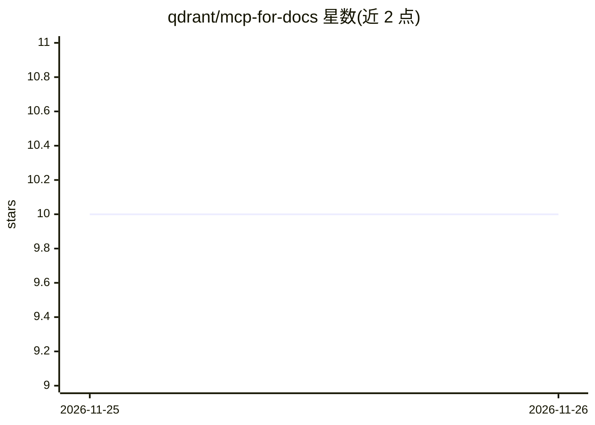

# qdrant/mcp-for-docs

⭐ 10 · Python · 推送 2026-06-23 · [GitHub](https://github.com/qdrant/mcp-for-docs) · 组织维护

**给 LLM 提供开发工具文档检索的 MCP 服务器**

基于 mcp-server-qdrant 构建的文档 MCP 服务器 PoC，面向需要最新、准确文档的开发者场景：LLM 通过 MCP 协议只读检索特定包的文档与代码片段，模型仅被允许检索数据，不能写入。README 定位为如何为特定包文档构建即用型 MCP 服务器的示例，使用 uv 管理 Python 依赖，支持 SSE 传输方式运行，并可用 MCP Server Inspector 做开发调试。

## 筛选速览

| 维度 | 判定 | 备注 |
|---|---|---|
| AI 角色 | `ai-ecosystem` | LLM/agent 周边工具 |
| 许可风险 | `none` | — |
| 部署形态 | `library` | 以包/库形式分发 |
| 模型依赖 | — | README 未给出锁定关系 |
| 硬件要求 | — | 无带数字的原话,不猜 |
| 安装摩擦 | `low` | 无编译、无系统依赖或容器化 |
| 成熟度 | — | 结构信号不足 |

## 能力要点

- 基于 mcp-server-qdrant 的只读文档检索 MCP 服务器
- 为特定包文档构建即用型 MCP 服务器的示例
- 支持 SSE 传输运行，附 MCP Server Inspector 调试方式

## 适用场景

- 让 AI 编码助手检索开发工具的最新文档和代码片段
- 为特定包文档搭建只读 MCP 服务器的参考实现

## 场景标签

`RAG` · 领域:知识与检索

## 证据(README 行号)

> L3: The idea is to create a PoC for curated documentation MCP server based on `mcp-server-qdrant`.
> L10: This project should serve as an example of how you can build ready-to-use MCP server for a specific package documen
> L12: This MCP server is read-only, model is only allowed retrieve data about the documentation.

## 星数曲线

2026-11-25 10 → 2026-11-26 10（+0）

---
*卡片 v1 · prompt 1.4 · 生成 2026-11-24 · 置信度 high · 依据 README sha `5004f9f59196` · [字段定义](../../DATASET.md)*
