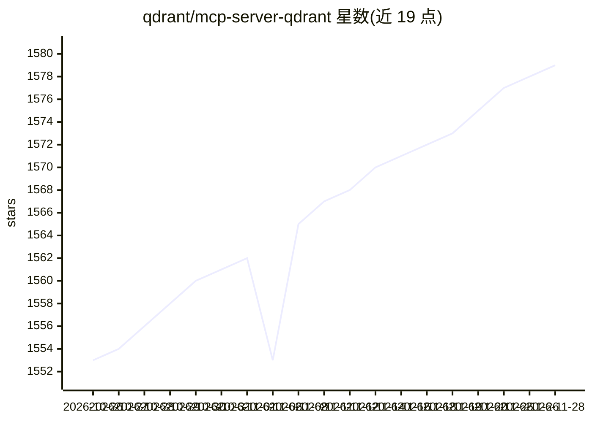

# qdrant/mcp-server-qdrant

⭐ 1,579 · Python · Apache-2.0 · 推送 2026-11-27 · [GitHub](https://github.com/qdrant/mcp-server-qdrant) · [官网](https://qdrant.tech) · 组织维护

**给 MCP 客户端提供 Qdrant 语义记忆存取的服务器**

Qdrant 官方的 Model Context Protocol 服务器实现，在 Qdrant 向量数据库之上提供语义记忆层，暴露 qdrant-store 与 qdrant-find 两个工具供 MCP 客户端存储和检索信息。通过环境变量配置（Qdrant 服务器 URL/API key 或本地数据库路径、嵌入模型、默认集合、只读模式等），嵌入仅支持 FastEmbed 模型，默认 all-MiniLM-L6-v2。支持 stdio/SSE/streamable-http 三种传输协议，README 另给出将其配置为 Cursor/Windsurf/Claude Code 语义代码搜索工具的定制说明。

## 筛选速览

| 维度 | 判定 | 备注 |
|---|---|---|
| AI 角色 | `ai-ecosystem` | LLM/agent 周边工具 |
| 许可风险 | `permissive` | Apache-2.0 |
| 部署形态 | `self-host` | docker 或自建部署 |
| 模型依赖 | — | README 未给出锁定关系 |
| 硬件要求 | — | 无带数字的原话,不猜 |
| 安装摩擦 | `low` | 无编译、无系统依赖或容器化 |
| 成熟度 | — | 结构信号不足 |

## 能力要点

- 提供 qdrant-store / qdrant-find 两个 MCP 工具存取语义记忆
- 支持 stdio、SSE、streamable-http 三种传输协议
- 支持远程 Qdrant 服务器或 QDRANT_LOCAL_PATH 本地数据库两种后端
- 可自定义工具描述以适配 Cursor/Windsurf 代码搜索场景

## 适用场景

- 为支持 MCP 的客户端接入 Qdrant 语义记忆存取
- 在 Cursor/Windsurf/Claude Code 中做代码片段语义搜索
- 通过 SSE 在团队或云端共享记忆服务器

## 场景标签

`语义搜索` `Agent 记忆` · 领域:Agent 开发

## 证据(README 行号)

> L10: This repository is an example of how to create a MCP server for Qdrant, a vector search engine.
> L14: An official Model Context Protocol server for keeping and retrieving memories in the Qdrant vector search engine.
> L194: This MCP server can be used with any MCP-compatible client. For example, you can use it with

## 星数曲线

2026-10-26 1,553 → 2026-11-28 1,579（+26）

---
*卡片 v1 · prompt 1.4 · 生成 2026-11-28 · 置信度 high · 依据 README sha `1848f3c424c8` · [字段定义](../../DATASET.md)*
