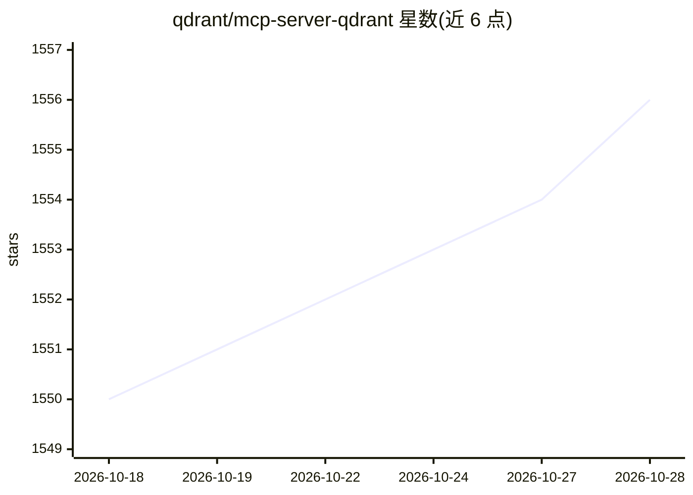

# qdrant/mcp-server-qdrant

⭐ 1,556 · Python · Apache-2.0 · 推送 2026-09-04 · [GitHub](https://github.com/qdrant/mcp-server-qdrant) · [官网](https://qdrant.tech) · 组织维护

**为 LLM 客户端提供基于 Qdrant 的语义记忆层 MCP 服务器**

Qdrant 官方维护的 Model Context Protocol 服务器实现，在 Qdrant 向量数据库之上提供语义记忆存储与检索层。提供 qdrant-store 与 qdrant-find 两个工具，通过环境变量配置 Qdrant 连接（服务器 URL 或本地路径）、嵌入模型（目前仅支持 FastEmbed，默认 all-MiniLM-L6-v2）与搜索参数。支持 stdio/SSE/streamable-http 三种传输协议，可通过 uvx 直接运行或 Docker 构建，并可接入 Claude Desktop、Cursor、Windsurf、VS Code 等 MCP 兼容客户端，支持只读模式。

## 筛选速览

| 维度 | 判定 | 备注 |
|---|---|---|
| AI 角色 | `ai-ecosystem` | LLM/agent 周边工具 |
| 许可风险 | `permissive` | Apache-2.0 |
| 部署形态 | `self-host` | docker 或自建部署 |
| 模型依赖 | — | README 未给出锁定关系 |
| 硬件要求 | — | 无带数字的原话,不猜 |
| 安装摩擦 | `low` | 无编译、无系统依赖或容器化 |
| 成熟度 | — | 结构信号不足 |

## 能力要点

- qdrant-store / qdrant-find 两个记忆存储与语义检索工具
- 支持 stdio、SSE、streamable-http 三种传输协议
- 可通过自定义工具描述改造为代码片段语义搜索工具
- 支持远程 Qdrant 服务器或本地路径两种存储模式

## 适用场景

- 为 Claude Desktop / Cursor 等 MCP 客户端添加持久记忆能力
- 团队共享的代码片段语义搜索服务
- 为 AI 工作流提供可检索的知识/笔记存储

## 场景标签

`语义搜索` `Agent 记忆` · 领域:Agent 开发

## 证据(README 行号)

> L5: > The Model Context Protocol (MCP) is an open protocol that enables
> L14: An official Model Context Protocol server for keeping and retrieving memories in the Qdrant vector search engine.

## 星数曲线

2026-10-18 1,550 → 2026-10-28 1,556（+6）

---
*卡片 v1 · prompt 1.4 · 生成 2026-10-21 · 置信度 mid · 依据 README sha `24fb164d7567` · [字段定义](../../DATASET.md)*
