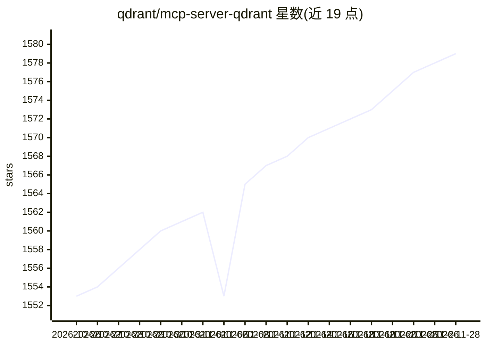

# qdrant/mcp-server-qdrant

⭐ 1,579 · Python · Apache-2.0 · 推送 2026-11-27 · [GitHub](https://github.com/qdrant/mcp-server-qdrant) · [官网](https://qdrant.tech) · 组织维护

**给 MCP 客户端提供 Qdrant 语义记忆存取的官方服务器**

Qdrant 官方的 Model Context Protocol 服务器，在 Qdrant 向量数据库之上提供语义记忆层：暴露 qdrant-store 与 qdrant-find 两个工具，分别用于存入和按语义检索信息。通过环境变量配置 Qdrant URL/本地路径、默认集合、嵌入模型（仅支持 FastEmbed）、只读模式等；支持 stdio、SSE、streamable-http 三种传输协议。可用 uvx 直接运行或 Docker 构建运行，README 给出 Claude Desktop、Cursor、Windsurf、Claude Code、VS Code 的接入配置。

## 筛选速览

| 维度 | 判定 | 备注 |
|---|---|---|
| AI 角色 | `ai-ecosystem` | LLM/agent 周边工具 |
| 许可风险 | `permissive` | Apache-2.0 |
| 部署形态 | `self-host` | docker 或自建部署 |
| 模型依赖 | — | README 未给出锁定关系 |
| 硬件要求 | — | 无带数字的原话,不猜 |
| 安装摩擦 | `low` | 无编译、无系统依赖或容器化 |
| 成熟度 | — | 结构信号不足 |

## 能力要点

- 提供 qdrant-store 与 qdrant-find 两个 MCP 工具，实现信息存取与语义检索
- 支持 stdio/SSE/streamable-http 三种传输协议，可本地或远程运行
- 支持 Qdrant 远程服务器与本地数据库路径两种存储方式
- 可自定义工具描述，用作 Cursor/Windsurf/Claude Code 的代码语义搜索工具

## 适用场景

- 为 Claude Desktop 等支持 MCP 的客户端添加可持久化的语义记忆
- 在 Cursor/Windsurf/Claude Code 中对代码片段做自然语言语义检索
- 团队通过 SSE 在云端共享同一个 Qdrant 记忆服务

## 场景标签

`语义搜索` `Agent 记忆` · 领域:Agent 开发

## 证据(README 行号)

> L10: This repository is an example of how to create a MCP server for Qdrant, a vector search engine.
> L14: An official Model Context Protocol server for keeping and retrieving memories in the Qdrant vector search engine.
> L15: It acts as a semantic memory layer on top of the Qdrant database.

## 星数曲线

2026-10-26 1,553 → 2026-11-28 1,579（+26）

---
*卡片 v1 · prompt 1.4 · 生成 2026-11-26 · 置信度 high · 依据 README sha `a4e99faa1e25` · [字段定义](../../DATASET.md)*
