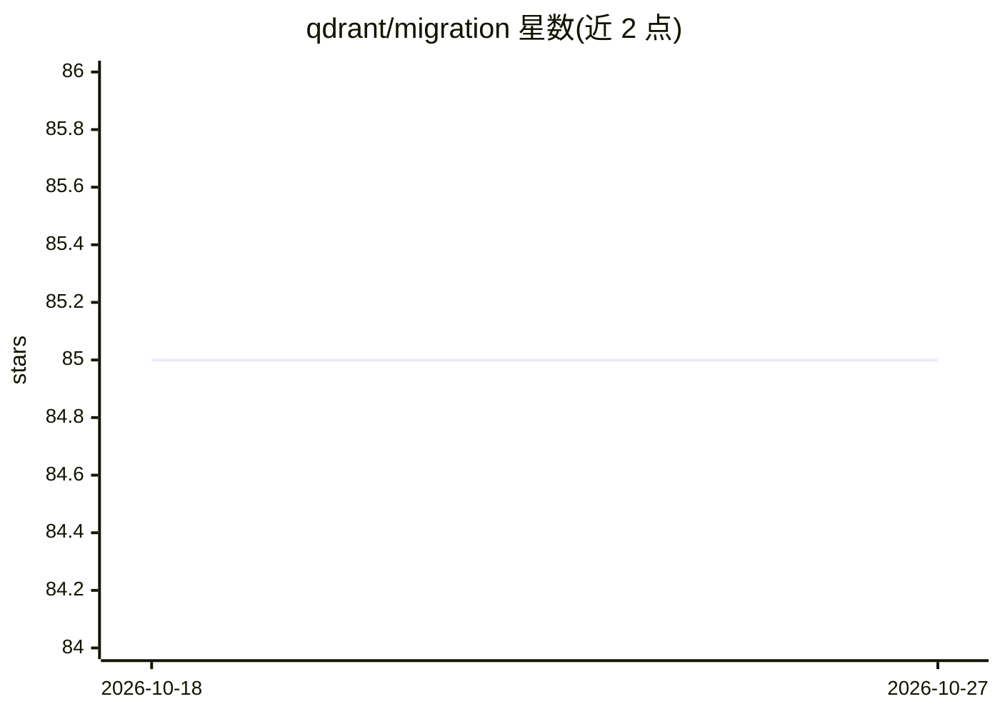

# qdrant/migration

⭐ 85 · Go · Apache-2.0 · 推送 2026-10-23 · [GitHub](https://github.com/qdrant/migration) · 组织维护

**将 17 种向量库/数据源的数据迁移到 Qdrant 的 CLI 工具**

Qdrant 官方维护的数据迁移 CLI：从 Chroma、Pinecone、Milvus、Weaviate、Redis、MongoDB、OpenSearch、Elasticsearch、Azure AI Search、pgvector、FAISS、S3 Vectors、DynamoDB、Turbopuffer、Solr 及其他 Qdrant 实例等 17 种源读取数据写入 Qdrant，支持中断后可恢复传输。以容器镜像和独立二进制分发（Chroma 与 FAISS 仅容器镜像支持）；macOS/Linux 可用 Homebrew 安装二进制。限制：Weaviate/Redis/MongoDB 等源需在迁移前手动创建 Qdrant 集合并匹配向量维度；Pinecone 仅 serverless 索引支持完整列举。

## 筛选速览

| 维度 | 判定 | 备注 |
|---|---|---|
| AI 角色 | `ai-ecosystem` | LLM/agent 周边工具 |
| 许可风险 | `permissive` | Apache-2.0 |
| 部署形态 | `self-host` | docker 或自建部署 |
| 模型依赖 | — | README 未给出锁定关系 |
| 硬件要求 | — | 无带数字的原话,不猜 |
| 安装摩擦 | `low` | 无编译、无系统依赖或容器化 |
| 成熟度 | — | 结构信号不足 |

## 能力要点

- 17 种数据源到 Qdrant 的迁移通道
- 支持中断后可恢复（resumable）传输
- 容器镜像与独立二进制两种分发形式
- 每个源提供独立的 CLI 参数集（认证、集合、TLS 等）

## 适用场景

- 把现有 Pinecone/Milvus/Chroma 向量库迁移到 Qdrant
- 搜索引擎/数据库（Elasticsearch、Solr、MongoDB）中的向量数据迁移入库
- Qdrant 实例之间的数据搬迁

## 场景标签

`向量数据库` · 领域:知识与检索

## 证据(README 行号)

> L3: CLI tool for migrating data to Qdrant with support for resumable transfers in case of interruptions.
> L5: ## Supported Sources

## 星数曲线

2026-10-18 85 → 2026-10-27 85（+0）

---
*卡片 v1 · prompt 1.4 · 生成 2026-10-24 · 置信度 high · 依据 README sha `c963b34dd299` · [字段定义](../../DATASET.md)*
