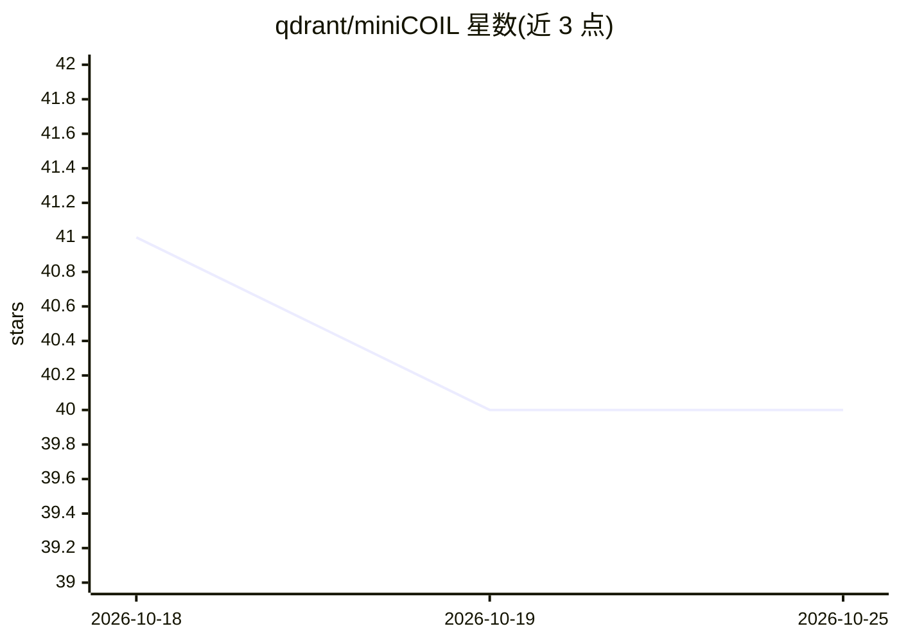

# qdrant/miniCOIL

⭐ 40 · Python · 推送 2026-09-02 · [GitHub](https://github.com/qdrant/miniCOIL) · 组织维护

**上下文相关的逐词小型嵌入模型（8d/4d）**

由 Qdrant 维护的逐词嵌入模型：为句子中每个词生成极小维度（8d 甚至 4d）的上下文化向量，仅可跨句比较同一词的嵌入。它以词汇表上每词一个线性层的形式叠加在基础 transformer（如 SentenceTransformers）之上，非端到端训练，无法为词分配相对权重，但可与 BM25 类打分结合用于搜索引擎。训练流程基于 openwebtext 数据集，涵盖句子切分、编码、上传 Qdrant 采样、三元组训练、量化与 ONNX 转换等步骤。

## 筛选速览

| 维度 | 判定 | 备注 |
|---|---|---|
| AI 角色 | `ai-native` | 本体是模型或模型工具 |
| 许可风险 | `none` | — |
| 部署形态 | `None` |  |
| 模型依赖 | — | README 未给出锁定关系 |
| 硬件要求 | — | 无带数字的原话,不猜 |
| 安装摩擦 | `low` | 无编译、无系统依赖或容器化 |
| 成熟度 | — | 结构信号不足 |

## 能力要点

- 为每个词生成 8d/4d 上下文化嵌入，保留词义区分（如 bank 的不同含义）
- 架构为每个词一个线性层的轻量层，叠加在基础 transformer 之上
- 训练数据管道覆盖 openwebtext 处理、Qdrant 采样、三元组训练、量化与 ONNX 转换

## 适用场景

- 信息检索中消解多义词的上下文含义
- 与 BM25 打分结合增强搜索引擎的精确匹配
- 在单步推理中与稠密嵌入联合使用

## 场景标签

`语义搜索` · 领域:知识与检索

## 证据(README 行号)

> L3: MiniCOIL is a contextualized per-word embedding model.
> L6: This restriction allows to generate an extremely small embeddings (8d or even 4d) while still preserving the context
> L10: MiniCOIL embeddings might be useful in information retrieval tasks, where we need to resolve meaning of the word in

## 星数曲线

2026-10-18 41 → 2026-10-25 40（-1）

---
*卡片 v1 · prompt 1.4 · 生成 2026-10-25 · 置信度 high · 依据 README sha `882d7af1c89f` · [字段定义](../../DATASET.md)*
