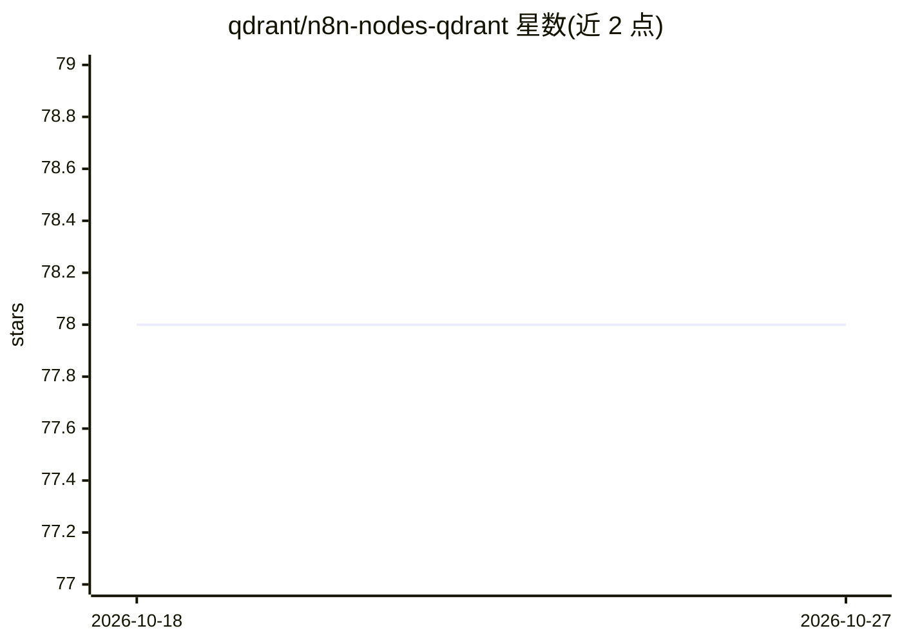

# qdrant/n8n-nodes-qdrant

⭐ 78 · TypeScript · MIT · 推送 2026-10-20 · [GitHub](https://github.com/qdrant/n8n-nodes-qdrant) · [官网](https://qdrant.tech) · 组织维护

**n8n 官方 Qdrant 节点：在工作流中操作向量数据库**

Qdrant 官方维护的 n8n 社区节点，用于在 n8n 工作流中连接并操作 Qdrant 向量数据库实例。支持 Collection（创建/更新/删除/查询集合）、Point（upsert/检索/批量更新/滚动/计数）、Vector（更新/删除向量）、Search（相似度查询、批量查询、分组、距离矩阵）与 Payload（设置/覆盖/删除/索引/统计）五类操作。通过 REST URL 与可选 API Key 配置凭证，兼容 Qdrant 1.14.0 及以上版本。安装遵循 n8n 社区节点文档。

## 筛选速览

| 维度 | 判定 | 备注 |
|---|---|---|
| AI 角色 | `ai-ecosystem` | LLM/agent 周边工具 |
| 许可风险 | `permissive` | MIT |
| 部署形态 | `None` |  |
| 模型依赖 | — | README 未给出锁定关系 |
| 硬件要求 | — | 无带数字的原话,不猜 |
| 安装摩擦 | `low` | 无编译、无系统依赖或容器化 |
| 成熟度 | — | 结构信号不足 |

## 能力要点

- 覆盖集合、点、向量、检索、Payload 五类共 30 余项操作
- 官方 n8n 节点，由 Qdrant 维护
- 通过 REST URL 与可选 API Key 连接 Qdrant 实例，兼容 1.14.0+

## 适用场景

- 在 n8n 工作流中读写 Qdrant 向量库实现检索
- 对 Qdrant 集合与数据进行批量管理与索引操作
- 把向量相似度搜索纳入自动化流程

## 场景标签

`向量数据库` · 领域:知识与检索

## 证据(README 行号)

> L5: This is the official n8n node for interfacing with Qdrant.
> L7: Qdrant is a vector similarity search engine that provides a production-ready service with a convenient API to store,

## 星数曲线

2026-10-18 78 → 2026-10-27 78（+0）

---
*卡片 v1 · prompt 1.4 · 生成 2026-10-24 · 置信度 high · 依据 README sha `853ce43db954` · [字段定义](../../DATASET.md)*
