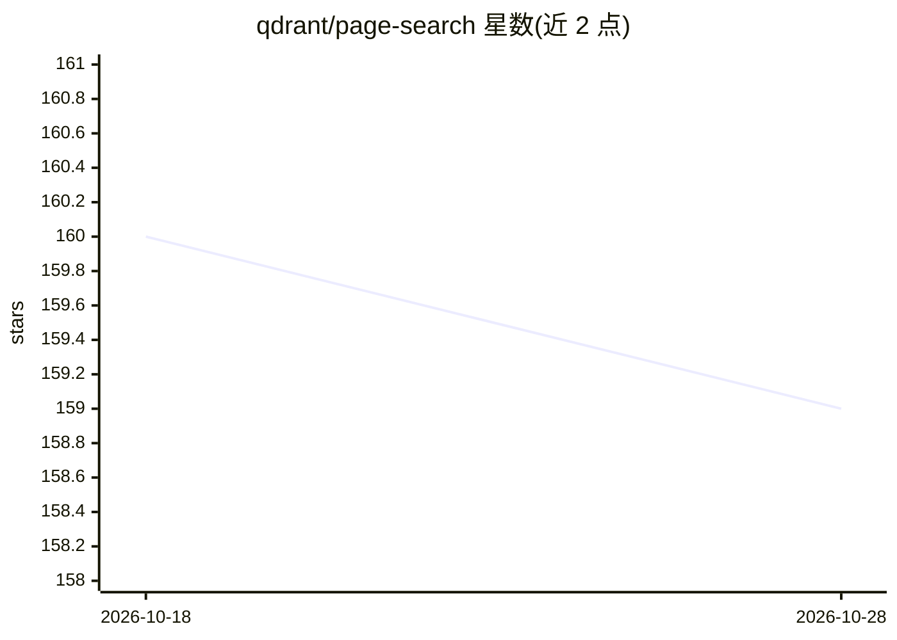

# qdrant/page-search

⭐ 159 · Rust · Apache-2.0 · 推送 2026-10-23 · [GitHub](https://github.com/qdrant/page-search) · 组织维护

**为网站/文档提供毫秒级语义搜索的服务（Python 与 Rust 双实现）**

由 Qdrant 团队维护的网页语义搜索服务，含 Python 与 Rust 两个实现：均接入 Qdrant 向量搜索引擎，使用 Hugging Face 的 all-MiniLM-L6-v2 模型生成嵌入。Python 版在输入不足 4 字符时退化为文本搜索，Rust 版始终执行完整语义搜索；两者均暴露相同的 GET /api/search 端点，支持 q 检索词与可选的 section 参数按页面分区过滤。该代码用于驱动 Qdrant 官方文档站的搜索框。README 未给出安装运行命令，细节位于 dev-docs.md 与 rust_search 的 README 中。

## 筛选速览

| 维度 | 判定 | 备注 |
|---|---|---|
| AI 角色 | `ai-native` | 本体是模型或模型工具 |
| 许可风险 | `permissive` | Apache-2.0 |
| 部署形态 | `None` |  |
| 模型依赖 | — | README 未给出锁定关系 |
| 硬件要求 | — | 无带数字的原话,不猜 |
| 安装摩擦 | `low` | 无编译、无系统依赖或容器化 |
| 成熟度 | — | 结构信号不足 |

## 能力要点

- Python 与 Rust 双实现，共用 GET /api/search 端点
- 使用 all-MiniLM-L6-v2 模型生成嵌入，Qdrant 执行向量检索
- section 参数支持按页面分区过滤搜索结果
- 已用于驱动 Qdrant 官方文档站搜索

## 适用场景

- 为文档站或文章类网站添加语义搜索框
- 在短查询与语义检索间切换的站内搜索场景

## 场景标签

`语义搜索` · 领域:知识与检索

## 证据(README 行号)

> L5: Both the python and Rust version contain a service that is able to use a Qdrant vector search engine to do a semanti
> L7: Both versions use the all-MiniLM-L6-v2 model made available by Hugging Face for embedding, and Qdrant for searching.

## 星数曲线

2026-10-18 160 → 2026-10-28 159（-1）

---
*卡片 v1 · prompt 1.4 · 生成 2026-10-22 · 置信度 mid · 依据 README sha `13ad59d2941f` · [字段定义](../../DATASET.md)*
