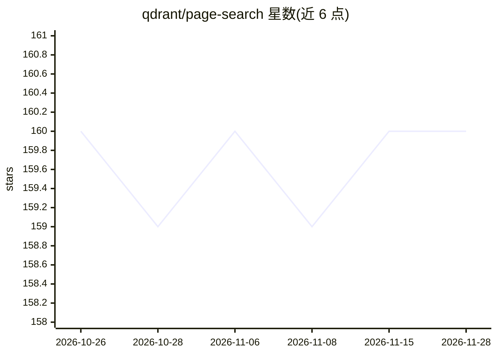

# qdrant/page-search

⭐ 160 · Rust · Apache-2.0 · 推送 2026-11-23 · [GitHub](https://github.com/qdrant/page-search) · 组织维护

**Qdrant 官方文档站的语义搜索服务**

驱动 qdrant.tech 搜索框的服务与索引器集合：Rust 编写的 service 从 Qdrant collection 响应搜索请求，Python/Rust 索引器每夜抓取 qdrant.tech 与 skills.qdrant.tech 内容并写入 collection。提供文档搜索、供 agent 使用的 Markdown 页面 /md、技能与代码示例搜索，以及文档 MCP 服务器 /mcp，在线运行于 search.qdrant.tech。六个 collection 分别支撑站点搜索、短查询前缀缓存、页面/章节/技能/代码片段检索。

## 筛选速览

| 维度 | 判定 | 备注 |
|---|---|---|
| AI 角色 | `ai-native` | 本体是模型或模型工具 |
| 许可风险 | `permissive` | Apache-2.0 |
| 部署形态 | `None` |  |
| 模型依赖 | — | README 未给出锁定关系 |
| 硬件要求 | — | 无带数字的原话,不猜 |
| 安装摩擦 | `low` | 无编译、无系统依赖或容器化 |
| 成熟度 | — | 结构信号不足 |

## 能力要点

- 文档搜索 API 与 docs MCP 服务器（/mcp）
- 供 agent 使用的 Markdown 页面端点 /md
- 每夜自动抓取与重建索引的 workflow
- 覆盖站点、章节、页面、技能、代码片段六类 collection

## 适用场景

- 在 Qdrant 文档站内做语义搜索
- 让 agent 通过 /md 或 MCP 读取文档内容
- 检索代码示例与技能片段

## 场景标签

`语义搜索` · 领域:知识与检索

## 证据(README 行号)

> L3: The search behind qdrant.tech: the search box of the
> L5: search, and a docs MCP server at `/mcp`. It runs at `https://search.qdrant.tech`.
> L9: - **The service**, in Rust, in `service`. It answers every

## 星数曲线

2026-10-26 160 → 2026-11-28 160（+0）

---
*卡片 v1 · prompt 1.4 · 生成 2026-11-27 · 置信度 mid · 依据 README sha `7f335f1bbc75` · [字段定义](../../DATASET.md)*
