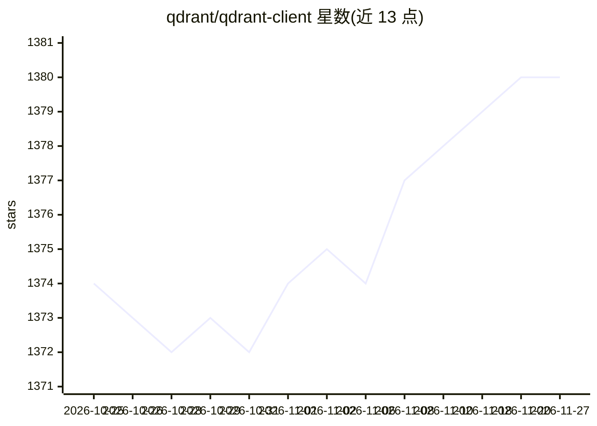

# qdrant/qdrant-client

⭐ 1,380 · Python · Apache-2.0 · 推送 2026-11-25 · [GitHub](https://github.com/qdrant/qdrant-client) · [官网](https://qdrant.tech) · 组织维护

**Qdrant 向量搜索引擎的 Python 客户端库与 SDK**

为 Qdrant 向量搜索引擎提供官方 Python SDK，覆盖全部 Qdrant API 的类型定义，支持同步与异步请求、REST 与 gRPC 两种协议。提供本地模式（:memory: 或持久化路径），无需运行服务器即可在开发、测试、CI/CD、Colab/Jupyter 中使用相同 API，规模扩大时切换到服务器或云模式。内置 Inference API，可经 FastEmbed 在本地生成嵌入，或使用 Qdrant Cloud 托管模型远程推理。通过 pip 安装。

## 筛选速览

| 维度 | 判定 | 备注 |
|---|---|---|
| AI 角色 | `ai-ecosystem` | LLM/agent 周边工具 |
| 许可风险 | `permissive` | Apache-2.0 |
| 部署形态 | `self-host` | docker 或自建部署 |
| 模型依赖 | — | README 未给出锁定关系 |
| 硬件要求 | — | 无带数字的原话,不猜 |
| 安装摩擦 | `low` | 无编译、无系统依赖或容器化 |
| 成熟度 | — | 结构信号不足 |

## 能力要点

- 覆盖全部 Qdrant API 方法的类型定义与同步/异步客户端
- 本地模式无需运行服务器，支持内存与磁盘持久化
- REST 与 gRPC 双协议支持，gRPC 加速批量上传
- Inference API 支持本地 FastEmbed 与 Qdrant Cloud 远程嵌入生成

## 适用场景

- 在 CI/CD 或 Jupyter 中不部署服务器即可测试向量检索代码
- 为应用接入 Qdrant 向量搜索并管理集合与向量上传
- 使用条件过滤查询相似向量
- 通过 FastEmbed 或云端模型生成嵌入并直接入库

## 场景标签

`语义搜索` · 领域:知识与检索

## 证据(README 行号)

> L3:  Python Client library for the Qdrant vector search engine.
> L13: Client library and SDK for the Qdrant vector search engine.
> L15: Library contains type definitions for all Qdrant API and allows to make both Sync and Async requests.

## 星数曲线

2026-10-25 1,374 → 2026-11-27 1,380（+6）

---
*卡片 v1 · prompt 1.4 · 生成 2026-11-24 · 置信度 mid · 依据 README sha `4952562eef1c` · [字段定义](../../DATASET.md)*
